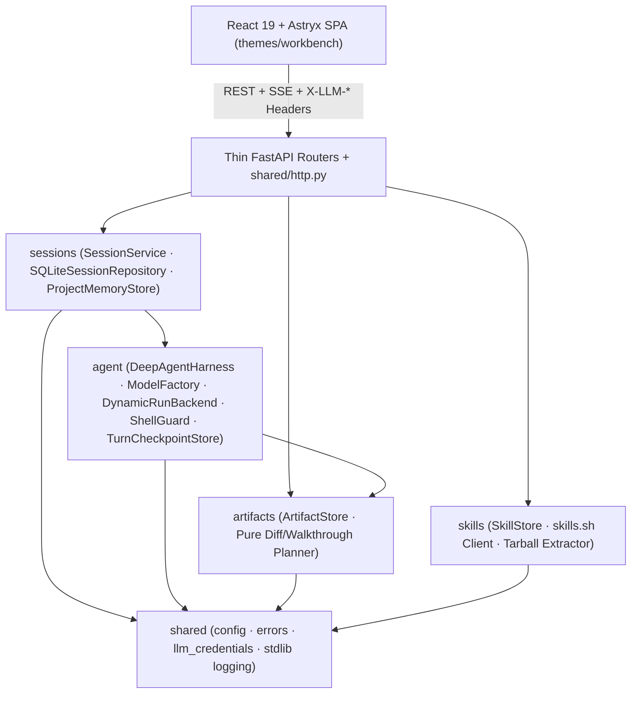

# 시스템 아키텍처 (Architecture Wiki)

로컬 파일시스템과 셸 위에서 안전하게 동작하기 위해 구성한 백엔드·에이전트 하네스·도메인 경계 요약입니다.

> 내부 동작 원리와 프레임워크 대비 직접 구현 범위를 상세히 정리한 문서는 **[코딩 에이전트 구현 Review (`docs/coding-agent-study.md`)](coding-agent-study.md)**를 참고하세요.

---

## 1. 전체 토폴로지 & 4개 DDD Bounded Context

도메인 간 순환 참조와 프레임워크 결합을 막기 위해 백엔드를 4개의 Bounded Context(`sessions`, `agent`, `artifacts`, `skills`)와 공통 계층(`shared`)으로 나누고, `tests/test_architecture_boundaries.py`에서 Python AST 정적 검사로 경계를 강제합니다.

### 핵심 경계 및 런타임 규칙
- **순수 표준 라이브러리 모듈**: `shell_guard.py`, `walkthrough_diff.py`, `shared/logging.py`는 외부 패키지 의존성 없이 Python 표준 라이브러리만 사용합니다.
- **순수 엔티티**: 각 도메인의 `entities.py`는 표준 라이브러리 + `pydantic`만 허용합니다.
- **도메인 격리**: `artifacts` 도메인은 LangGraph/DeepAgents/FastAPI를 알지 못하며, `skills` 도메인은 다른 도메인에 의존하지 않습니다. 모든 `router.py`는 얇은 HTTP 어댑터 역할만 수행합니다.
- **브랜드와 인프라 분리**: 브랜드 이름(`APP_NAME = "Anvil"`)은 표시·페르소나 상수로만 격리하고, 저장 경로(`.data/sessions.db`), 환경변수(`DATA_DIR`, `SQLITE_JOURNAL_MODE`, `LOG_LEVEL`), `localStorage` 키, 테마(`workbench`)는 모두 역할 기반 이름을 사용합니다.
- **스토리지 경로 및 저널 모드 (`DATA_DIR` · `SQLITE_JOURNAL_MODE`)**: 기본값은 로컬 `.data` + `WAL`이며, 공유 네트워크 볼륨 환경에서는 절대 경로 + `DELETE` 모드를 환경변수로 지정할 수 있습니다. 기동 시 `verify_storage_writable()`로 쓰기 가능 여부를 선검증해 실패 시 즉시 기동을 중단하고, `recover_interrupted_runs()`로 비정상 종료로 남은 `running` 세션을 `idle`로 자동 복구합니다.
- **공용 HTTP 풀 및 동시 실행 차단**: `ModelFactory`는 단일 `httpx.Client` / `httpx.AsyncClient` 커넥션 풀을 공유해 앱 종료(`lifespan`) 시 `aclose()`로 정리하며, 동일 세션에 대한 중복 스트림 요청은 라우터 사전 검증(`Depends`) 단계에서 인메모리 활성 셋으로 즉시 차단(`409 SESSION_RUNNING`)합니다.

---

## 2. 에이전트 하네스 & 동적 백엔드 (`domains/agent/`)

단일 서버 프로세스에서 여러 프로젝트와 세션이 동시에 실행되더라도 상태가 섞이지 않도록 **컴파일된 LangGraph 인스턴스는 LRU 캐시로 재사용**하되, 실행 시점의 경로·권한은 `ContextVar`(`RunContext` / `RunCatalog`)에서 동적으로 주입합니다. LangGraph 스레드 체크포인트가 이미 존재하는 턴에서는 불필요한 DB 전체 메시지 재조회를 생략합니다.

| 가상 경로 / 백엔드 | 연결 대상 | 모드별 권한 |
| :--- | :--- | :--- |
| `/` (기본 워크스페이스) | 선택한 로컬 Git/폴더 경로 | `Ask`: 읽기 전용(`FilesystemBackend`) / `Plan`·`Auto`: `DynamicGuardedShellBackend` |
| `/artifacts/` | `.data/artifacts/{session_id}/` | 세션 격리 아티팩트(`implementation_plan.md`, `task.md`, `walkthrough.md`), 타깃 레포 오염 방지 |
| `/memories/project/` | `.data/memories/projects/{project_id}/` | 프로젝트별 장기 기억(`AGENTS.md`), `Ask` 및 승인 전 `Plan`에서는 읽기 전용 |
| `/skills/` | 내장(`builtin/`) + 전역(`.data/skills/`) + 워크스페이스(`.agents/skills/`) | 읽기 전용 가상 병합(`SkillFiles`) |

또한 대량 탐색(`explorer`)과 독립 코드 리뷰(`reviewer`) 서브에이전트는 읽기 전용 도구 가드가 적용된 별도 문맥에서 실행되며, 스트리밍 메타데이터(`lc_subagent_tool_call_id`, `lc_agent_name`)를 통해 부모 `task` 호출(`parent_id`) 아래로 정확히 연결됩니다.

---

## 3. 미들웨어 파이프라인

에이전트의 매 모델 호출과 도구 실행은 아래 9단계 미들웨어 체인을 순서대로 통과합니다:

1. **`TodoListMiddleware`**: `write_todos` 상태 관리
2. **`RunPromptMiddleware`**: 프롬프트 프리픽스 캐시 효율을 위해 정적 지침 → 모드별 정책 → 동적 세션 컨텍스트 순으로 시스템 프롬프트 배치
3. **`DynamicMemoryMiddleware`**: 매 턴 레포지토리 `/AGENTS.md`와 프로젝트 장기 기억 `/memories/project/AGENTS.md`를 최신 상태로 로드
4. **`SubdirAgentsReadMiddleware`**: 하위 디렉터리 파일을 읽을 때 상위 경로의 로컬 `AGENTS.md` 규칙을 지연 주입
5. **`ToolErrorMiddleware` & `ModelRetryMiddleware`**: LangGraph `interrupt()`와 취소 예외(`CancelledError`)는 그대로 전파하고, 일반 도구 오류만 모델이 복구 가능한 `ToolMessage`로 변환
6. **`GitEvidenceMiddleware`**: 턴 시작 전 베이스라인 스냅샷(`TurnCheckpointStore`) 캡처 및 변경 도구 실행 직후 단일 프로세스(`git status --porcelain=v2 --branch -z`)로 Git 상태 갱신
7. **`VerificationLoopMiddleware`**: 워크스페이스 수정 여부와 검증 명령(`pytest`, `ruff`, `npm test` 등) 통과 여부를 추적하고, 연속 3회 실패 시 Three-Strike 중단 가이드 주입 및 `verification_stamp` 기록
8. **`ArtifactWorkflowMiddleware`**: 승인 전 `Plan` 모드의 파일/셸 변경 차단, 검증 규칙 파일(`is_verifier_rule_path`) 자기수정 승인 게이트, `plan_review` / `shell_approval` HITL 인터럽트 조율

---

## 4. 3계층 동기화 Revert 구조

특정 턴을 되돌릴 때(`POST /api/sessions/{id}/revert`) 파일과 에이전트 기억이 어긋나지 않도록 세 계층을 함께 되감습니다:

1. **파일시스템 계층 (`TurnCheckpointStore`)**: 콘텐츠 주소화(SHA-256) 블롭 스토어와 턴 매니페스트를 역순으로 적용해 수정/삭제된 파일을 복원하고 새로 생성된 파일·빈 폴더를 제거합니다. 스캔 시 `(mtime_ns, ctime_ns, size, ino)` 4종 스탬프와 2초 안전 창으로 Racy-Git 누락 없이 불필요한 재해싱을 건너뛰며, 스트림이 중도 취소(`abort`)되어도 `finalize_pending_capture`로 직전 변경 매니페스트를 회수해 복구 가능 상태를 유지합니다.
2. **트랜스크립트 계층 (`SQLiteSessionRepository`)**: 되돌린 턴부터 이후 메시지를 절삭하고, 원래 입력했던 사용자 프롬프트를 반환해 입력창에 복원합니다.
3. **LLM 체크포인트 계층 (`DeepAgentHarness`)**: 기존 LangGraph 스레드 체크포인트를 초기화(`reset_thread`)하고, 다음 메시지 전송 시 살아남은 이전 대화 이력(`prior_messages`)을 재주입해 모델이 되돌려진 코드를 여전히 존재한다고 착각하는 현상을 방지합니다.

---

## 5. 프론트엔드 연동 원칙 (`frontend/`)

- **원본 보존 + 순수 파생 뷰**: 백엔드 SSE 스트림과 메시지 원본 배열은 그대로 보존하고, 렌더링 직전 순수 셀렉터로만 탐색 도구 묶음·서브에이전트 실행 카드·되돌리기 영향 범위를 파생합니다.
- **Astryx 컴포넌트 기반 UI**: 커스텀 CSS나 인라인 스타일 없이 `@astryxdesign/core` 컴포넌트와 로컬 테마(`themes/workbench`) 조합만으로 화면을 구성합니다.
