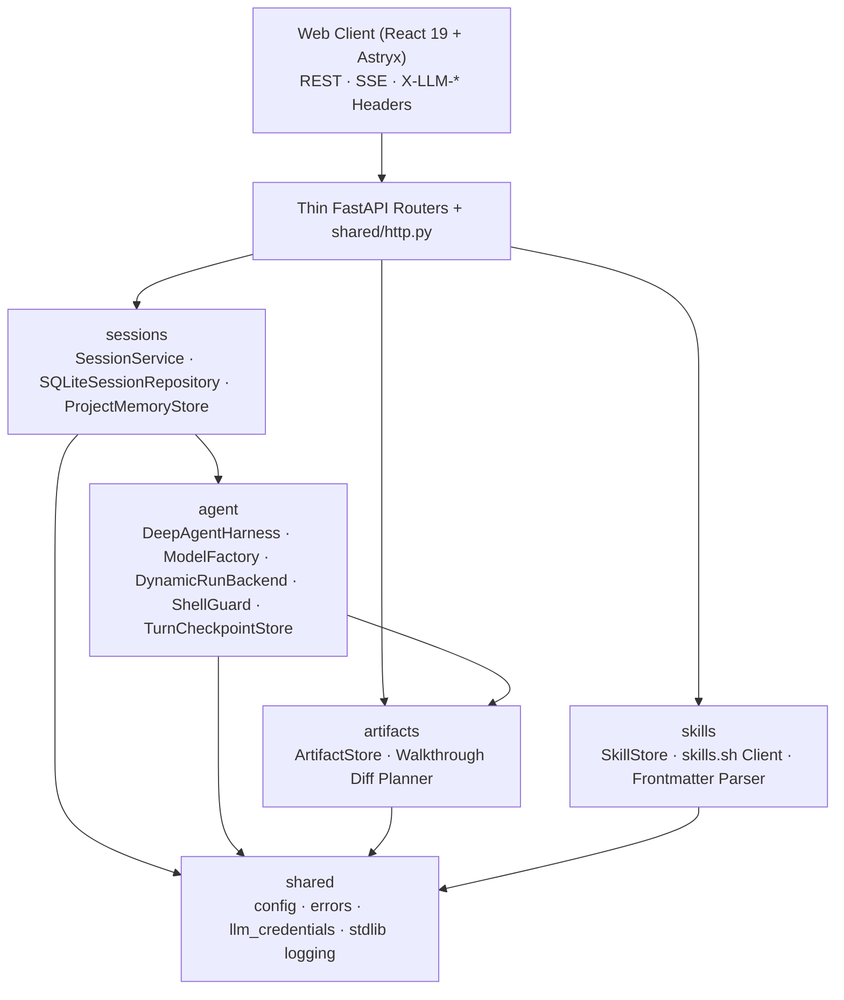

# 시스템 아키텍처

로컬 파일시스템과 셸 위에서 동작하는 코딩 에이전트의 디렉터리 구조, 도메인 경계, 런타임 파이프라인을 코드 기준으로 요약한 레퍼런스 문서입니다.

> Tool Calling 루프부터 Context 관리·Subagent·Interrupt·Revert까지의 상세 동작 원리는 **[코딩 에이전트 구현 Review (`docs/coding-agent-study.md`)](coding-agent-study.md)**를 참고하세요.

---

## 1. 디렉터리 구조 및 DDD Bounded Contexts

도메인 간 순환 참조와 프레임워크 결합을 막기 위해 백엔드를 역할별 Bounded Context(`sessions`, `agent`, `artifacts`, `skills`)와 공통 계층(`shared`)으로 분리하고, `tests/test_architecture_boundaries.py`에서 파이썬 `ast` 모듈로 모든 파일의 `import` 규칙을 검증합니다.

```text
backend/app/
├── main.py                        # FastAPI 앱 진입점 · lifespan(스토리지 검증, 상태 복구, HTTP 풀 종료) · 정적 SPA 서빙
├── shared/                        # config · errors · llm_credentials · logging(표준 라이브러리) · http · dependencies
└── domains/
    ├── sessions/                  # 프로젝트·세션 생명주기, SSE 스트림 소비·영속화, 동기화 Revert 조율, 프로젝트 메모리
    ├── agent/                     # DeepAgentHarness, ModelFactory, DynamicRunBackend, ShellGuard, Subagents, Checkpoints, Middleware
    ├── artifacts/                 # 세션 산출물(implementation_plan · task · walkthrough) 스토어 및 Git Diff 청크 매핑
    └── skills/                    # 내장(builtin/) · 전역 · 워크스페이스 SKILL.md 로더 및 skills.sh 레지스트리 설치기
```



### 아키텍처 경계 불변 규칙 (`tests/test_architecture_boundaries.py`)

- **순수 표준 라이브러리 모듈**: `domains/agent/shell_guard.py`, `domains/artifacts/walkthrough_diff.py`, `shared/logging.py`는 외부 패키지 없이 Python 표준 라이브러리만 사용합니다.
- **순수 엔티티**: 각 도메인의 `entities.py`는 표준 라이브러리와 `pydantic`만 허용합니다.
- **도메인 간 격리**:
  - `agent` 도메인(`router.py` 제외)은 `sessions`나 `fastapi`/`starlette`를 참조하지 않습니다.
  - `artifacts` 도메인(`router.py` 제외)은 `sessions`, `agent`, `langgraph`, `deepagents`, `fastapi`를 참조하지 않습니다.
  - `skills` 도메인(`router.py` 제외)은 다른 비즈니스 도메인에 의존하지 않으며, 내장 스킬은 `domains/skills/builtin/<name>/SKILL.md` 아래에만 둡니다.
  - 모든 `router.py`는 HTTP 변환만 담당하며 `sqlite3`, `aiosqlite`, `langgraph`, `deepagents`, `subprocess`를 직접 호출하지 않습니다.
- **표시 상수와 내부 식별자 분리**: 서비스 표기 이름(`APP_NAME`)은 UI·페르소나 상수로만 격리하고, 저장 경로(`.data/sessions.db`), 환경변수(`DATA_DIR`, `SQLITE_JOURNAL_MODE`, `LOG_LEVEL`), `localStorage` 키, 테마(`themes/workbench`)는 모두 역할 기반 이름을 사용합니다.

---

## 2. 에이전트 하네스 · Virtual FS · Subagent (`domains/agent/`)

단일 서버 프로세스에서 여러 프로젝트와 세션이 동시에 실행되더라도 상태가 섞이지 않도록 **컴파일된 LangGraph 인스턴스는 `(모델 설정 해시, 실행 모드)` 키로 LRU 캐시에서 재사용**하고, 실제 실행 경로와 권한 객체(`RunCatalog`)는 요청별 `ContextVar`(`RunContext`)로 바인딩합니다.

- **커넥션 풀 공유 (`model_adapter.py`)**: `ModelFactory`는 프로세스 단위의 단일 `httpx.Client` / `httpx.AsyncClient`(`trust_env=False`, `max_retries=0`) 풀을 공유하고 앱 종료(`lifespan`) 시 `aclose()`로 정리합니다. 오픈소스 추론 서버의 `reasoning_content` 스트리밍 추출과 미지원 파라미터 폴백은 `ReasoningChatOpenAI`에서 처리합니다.
- **조건부 이력 시딩 (`service.py` · `harness.py`)**: 이미 LangGraph 스레드 체크포인트가 존재하는 세션에서는 매 턴 전체 DB 메시지를 다시 읽지 않고, 신규 스레드나 `Revert` 직후 재초기화된 스레드에만 `prior_messages`를 지연 조회해 주입합니다.

### Virtual Filesystem 마운트 구조 (`DynamicRunBackend`)

| 가상 경로 | 실제 연결 대상 | 실행 모드별 권한 |
| :--- | :--- | :--- |
| `/` (기본 워크스페이스) | 선택한 로컬 Git 저장소 / 폴더 | `Ask`: 읽기 전용(`FilesystemBackend`) / `Plan`·`Auto`: `DynamicGuardedShellBackend` |
| `/artifacts/` | `{DATA_DIR}/artifacts/{session_id}/` | 세션 격리 문서(`implementation_plan.md`, `task.md`, `walkthrough.md`), 타깃 저장소 오염 방지 |
| `/memories/project/` | `{DATA_DIR}/memories/projects/{project_id}/` | 프로젝트별 장기 기억(`AGENTS.md`), `Ask` 및 승인 전 `Plan`에서는 읽기 전용 |
| `/skills/` | `builtin/` + `{DATA_DIR}/skills/` + 워크스페이스 `.agents/skills/` | 읽기 전용 가상 병합(`SkillFiles`) |

### 코어 도구 및 읽기 전용 Subagent

- **코어 도구 구성**: `deepagents` 기본 파일·셸·위임 도구(`ls`, `glob`, `grep`, `read_file`, `write_file`, `edit_file`, `execute`, `task`)와 직접 구현한 구조화 질문 도구(`ask_user`)로 고정하고, 세부 절차 지식은 `/skills/<name>/SKILL.md` 문서로 분리합니다.
- **Subagent 문맥 격리 (`subagents.py` · `harness.py`)**: 대량 코드 탐색(`explorer`)과 변경분 검토(`reviewer`)는 부모 대화 이력과 분리된 독립 `sub_messages` 루프에서 실행되며 `ReadOnlyToolGuardMiddleware`로 쓰기·셸 도구가 원천 차단됩니다. 실행 중 발생하는 하위 도구 이벤트는 스트리밍 메타데이터(`lc_subagent_tool_call_id`, `lc_agent_name`)를 파싱해 부모 `task` 호출의 `parent_id`로 매핑합니다.

---

## 3. Middleware Pipeline (`domains/agent/middleware/`)

모델 호출과 도구 실행은 `DeepAgentHarness`에 등록된 아래 미들웨어 체인을 순서대로 통과합니다.

1. **`TodoListMiddleware`** *(LangChain 제공)* — `write_todos` 작업 체크리스트 상태 관리
2. **`RunPromptMiddleware`** *(직접 구현, `run_prompt.py`)* — Prompt Prefix Cache 적중률을 유지하도록 정적 기본 지침 → 모드 정책 → 프로젝트 메모리 → 세션 경로 순으로 시스템 프롬프트 조립
3. **`DynamicMemoryMiddleware`** *(확장 구현, `memory.py`)* — 매 턴 시작 시 루트 `/AGENTS.md`와 프로젝트 메모리 `/memories/project/AGENTS.md`를 디스크에서 재로드
4. **`SubdirAgentsReadMiddleware`** *(직접 구현, `subdir_agents.py`)* — 하위 디렉터리 파일을 처음 읽을 때 상위 경로의 로컬 `AGENTS.md` 규칙을 `ToolMessage`에 지연 주입
5. **`ToolErrorMiddleware`** *(직접 구현, `resilience.py`)* — 일반 도구 실행 오류는 모델 자가 교정용 `ToolMessage`로 감싸 반환하되, LangGraph `GraphBubbleUp`(`interrupt`)과 `CancelledError`는 삼키지 않고 즉시 전파
6. **`ModelRetryMiddleware`** *(직접 구현, `resilience.py`)* — 일시적 네트워크·엔드포인트 오류 지수 백오프 재시도
7. **`GitEvidenceMiddleware`** *(직접 구현, `git_evidence.py`)* — 턴 시작 전 베이스라인 파일 스냅샷(`TurnCheckpointStore`) 캡처 및 수정 직후 단일 프로세스(`git status --porcelain=v2 --branch -z`)로 Git 변경분 갱신
8. **`VerificationLoopMiddleware`** *(직접 구현, `verification.py`)* — 코드 수정 대비 검증 명령(`pytest`, `ruff`, `npm test` 등) 종료 코드 추적, 연속 3회 실패 시 Three-Strike 중단 가이드 주입, 수정 재발생 시 기존 통과 스탬프 무효화
9. **`ArtifactWorkflowMiddleware`** *(직접 구현, `workflow.py`)* — 승인 전 `Plan` 모드의 수정·셸 차단, 검증 기준 파일(`ShellGuard.is_verifier_rule_path`) 자기수정 승인 게이트, `plan_review` · `shell_approval` HITL 인터럽트 조율

---

## 4. 스토리지 · 동시성 · 동기화 Revert

### 런타임 스토리지 및 동시성 보호

- **데이터 경로 및 저널 모드 (`DATA_DIR` · `SQLITE_JOURNAL_MODE`)**: 기본값은 로컬 `.data` + `WAL`이며, 공유 네트워크 볼륨 환경에서는 절대 경로와 `DELETE` 모드를 환경변수로 지정할 수 있습니다. 서버 기동 시 `verify_storage_writable()`로 쓰기 가능 여부를 선검증해 실패 시 즉시 기동을 중단하고, `recover_interrupted_runs()`로 비정상 종료된 `running` 세션을 `idle`로 복구합니다.
- **동일 세션 중복 실행 차단 (`sessions/router.py`)**: SSE 스트림(`EventSourceResponse`)을 열기 전 라우터 `Depends` 단계에서 활성 세션 셋을 검사해 이미 실행 중인 세션 요청은 즉시 `409 SESSION_RUNNING`으로 거절합니다.
- **무저장 자격증명 보안 (`shared/llm_credentials.py` · `shared/logging.py`)**: LLM URL과 API 키는 매 요청 `X-LLM-*` 헤더로만 입력받으며 DB·체크포인트·캐시 키(SHA-256 해시 접두사만 사용)에 평문을 남기지 않습니다. 모든 로그는 `SecretRedactionFilter`를 통과합니다.

### 파일 · DB · 체크포인터 동기화 Revert (`POST /api/sessions/{id}/revert`)

특정 턴을 되돌릴 때 워크스페이스 파일과 LLM 기억이 어긋나지 않도록 세 저장소를 함께 되감습니다.

1. **파일시스템 복원 (`TurnCheckpointStore`, `domains/agent/checkpoints.py`)**: SHA-256 Content-Addressed 블롭 스토어와 턴 매니페스트를 역순으로 적용해 수정·삭제된 파일을 복원하고 신규 파일과 빈 디렉터리를 정리합니다. 스캔 시 `(mtime_ns, ctime_ns, size, ino)` 메타데이터와 2초 안전 창을 함께 검사해 Racy-Git 누락 없이 불필요한 재해싱을 건너뛰며, 실행 도중 스트림이 중단(`Abort`)되더라도 `asyncio.shield` 블록에서 `finalize_pending_capture`로 직전 변경 매니페스트를 회수합니다.
2. **대화 DB 절삭 (`SQLiteSessionRepository`, `domains/sessions/repository.py`)**: 대상 턴부터 이후 메시지를 삭제하고 원래 입력했던 프롬프트를 반환해 입력창에 복원합니다.
3. **LLM 기억 재동기화 (`DeepAgentHarness`, `domains/agent/harness.py`)**: 기존 LangGraph 스레드 체크포인트를 삭제(`reset_thread`)하고, 다음 턴 시작 시 남은 이전 대화(`prior_messages`)만 재주입해 모델이 이미 되돌려진 코드를 전제로 추론하는 환각을 차단합니다.

---

## 5. 프론트엔드 연동 원칙 (`frontend/`)

- **원본 보존 + 순수 파생 뷰**: 백엔드 SSE 스트림과 메시지 배열 원본은 변형 없이 유지하고, 렌더링 직전 순수 셀렉터 함수로만 연속 탐색 묶음(`ExplorationGroup`), 서브에이전트 실행 카드(`SubagentGroupView`), 되돌리기 영향 요약을 파생합니다.
- **Astryx 컴포넌트 기반 구성**: 커스텀 CSS 파일이나 인라인 스타일 없이 `@astryxdesign/core` 프리미티브와 워크벤치 테마(`frontend/themes/workbench`) 조합만으로 UI를 구성합니다.
