# 코딩 에이전트는 어떻게 만들어지고 움직이는가 — 6단계 토폴로지 해부와 구현 회고

이 문서는 텍스트만 주고받던 언어 모델(LLM)이 어떻게 로컬 코드베이스에서 에러 원인을 검색(`grep`)하고, 파일을 읽고 고치며(`read_file` · `edit_file`), 테스트를 돌려 검증(`execute`)하고, 잘못된 변경을 되돌리는(`Revert`) **코딩 에이전트**로 만들어지는지 처음부터 끝까지 실제 작동 원리로 풀어낸 기술 정리 문서입니다.

추상적인 개념 설명 대신 **`"테스트 에러 원인 찾아 고쳐줘"`**라는 요청 하나가 실제 코드와 JSON 데이터로 어떻게 처리되는지 따라가며, 최근 클로드 코드(Claude Code)를 비롯한 현업 코딩 에이전트들이 채택한 핵심 설계 흐름을 **6단계 파이프라인** 순서로 하나씩 조립합니다.

---

## 0. 전체 조감도: 런타임 배선도와 6단계 마스터 파이프라인

본격적인 구현 원리에 들어가기에 앞서, 코딩 에이전트를 구성하는 부품들이 런타임에 서로 어떻게 배선되어 있는지와 앞으로 살펴볼 6단계 조립 순서를 먼저 확인합니다.

### 0-1. 런타임 연결 토폴로지 (배선도)

아래 배선도는 사용자 요청이 들어왔을 때 에이전트 루프, LLM API, 파일·셸 실행기, 서브에이전트, 상태 저장소 사이로 어떤 데이터가 오가는지 보여줍니다.

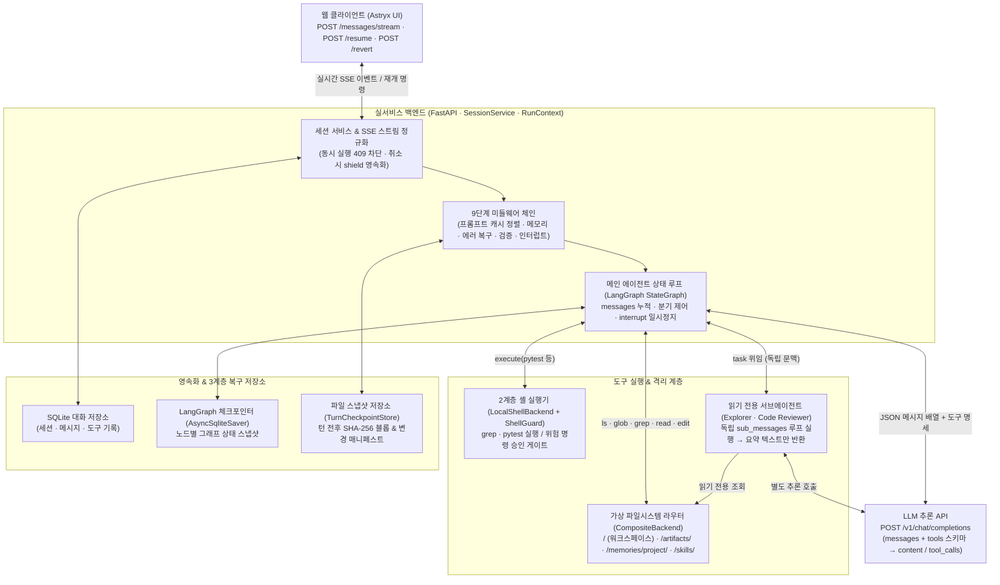

### 0-2. 가로 6단계 마스터 파이프라인

아래 6개 기둥은 가장 단순한 LLM 호출부터 실서비스 백엔드까지 코딩 에이전트를 완성해 나가는 전체 조립 순서입니다. 1장부터 6장까지는 매 장 시작마다 **현재 설명하는 단계 기둥을 파란색(`#1d4ed8`)으로 표시**하여 전체 구조 속 위치를 짚어가며 설명합니다.

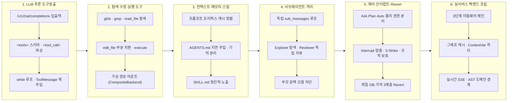

---

## 1장. LLM 추론과 도구 호출 루프 — 텍스트 모델이 코드를 만지는 기초 원리

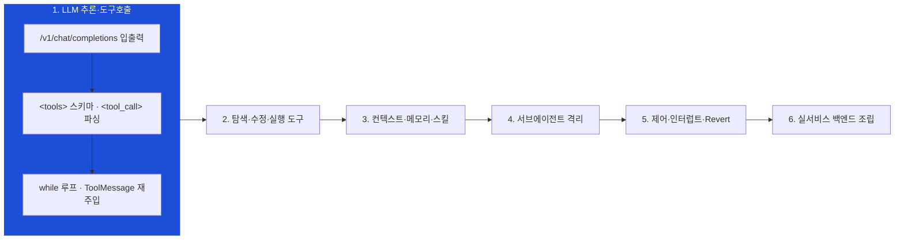

코딩 에이전트를 처음 접할 때 가장 먼저 짚어야 할 사실은 두 가지입니다. 첫째, **LLM API는 이전 대화를 기억하지 못하는 무상태(Stateless) HTTP 함수**입니다. 둘째, **LLM은 내 컴퓨터의 파일을 직접 열거나 터미널 명령을 실행할 능력이 전혀 없습니다.** 오직 텍스트(토큰)를 입력받아 다음 텍스트를 생성할 뿐입니다.

그렇다면 `"테스트 에러 원인 찾아 고쳐줘"`라고 입력했을 때 에이전트는 어떻게 동작할까요? 비밀은 **HTTP 요청 본문에 넣는 `tools` 명세**와 **백엔드의 `while` 반복문**에 있습니다.

### 1-1. `/v1/chat/completions` 요청과 `<tools>` / `<tool_call>`의 실체

백엔드 서버가 LLM 엔드포인트(`POST /v1/chat/completions`)를 호출할 때, 사용자 메시지뿐만 아니라 **백엔드가 대신 실행해 줄 수 있는 함수 목록(`tools` JSON Schema)**을 함께 보냅니다.

```json
{
  "model": "qwen3.8-flash",
  "messages": [
    { "role": "system", "content": "You are Anvil, a concise coding agent." },
    { "role": "user", "content": "테스트 에러 원인 찾아 고쳐줘" }
  ],
  "tools": [
    {
      "type": "function",
      "function": {
        "name": "execute",
        "description": "워크스페이스에서 셸 명령을 실행합니다.",
        "parameters": {
          "type": "object",
          "properties": { "command": { "type": "string" } },
          "required": ["command"]
        }
      }
    },
    {
      "type": "function",
      "function": {
        "name": "read_file",
        "description": "파일의 지정 줄 범위를 읽습니다.",
        "parameters": {
          "type": "object",
          "properties": {
            "file_path": { "type": "string" },
            "offset": { "type": "integer" },
            "limit": { "type": "integer" }
          },
          "required": ["file_path"]
        }
      }
    }
  ]
}
```

추론 서버(vLLM, OpenAI 등)는 위 JSON의 `tools` 배열을 모델의 프롬프트 템플릿 안 `<tools>...</tools>` 특수 블록으로 직렬화해 모델에 넣습니다. 모델은 질문을 읽고 *"지금 당장 답변할 수 없고 `pytest`를 먼저 돌려봐야겠다"*고 판단하면, 일반 답변 텍스트 대신 `<tool_call>{"name": "execute", "arguments": {"command": "pytest -q"}}</tool_call>` 토큰을 생성합니다.

추론 서버는 이 특수 토큰을 파싱해 아래와 같은 구조화된 `tool_calls` 응답으로 돌려줍니다.

```json
{
  "choices": [
    {
      "finish_reason": "tool_calls",
      "message": {
        "role": "assistant",
        "content": "",
        "reasoning_content": "먼저 pytest를 실행해 어떤 테스트가 실패하는지 확인합니다.",
        "tool_calls": [
          {
            "id": "call_01",
            "type": "function",
            "function": {
              "name": "execute",
              "arguments": "{\"command\": \"pytest -q\"}"
            }
          }
        ]
      }
    }
  ]
}
```

### 1-2. 에이전트의 심장: `while` 루프와 `ToolMessage` 재주입

모델이 `tool_calls`를 반환했다고 해서 명령이 저절로 실행되지는 않습니다. 우리 백엔드 코드가 이 JSON을 읽고 실제로 `pytest -q` 서브프로세스를 띄운 뒤, 그 표준 출력 결과를 **`role: "tool"` 메시지(`ToolMessage`)로 포장해 기존 `messages` 배열 맨 끝에 추가하고 LLM API를 다시 호출**합니다.

가장 원초적인 코딩 에이전트 루프를 파이썬 코드로 적으면 정확히 아래 20줄입니다.

```python
messages = [
    {"role": "system", "content": SYSTEM_PROMPT},
    {"role": "user", "content": "테스트 에러 원인 찾아 고쳐줘"},
]

while True:
    # 1. 누적된 전체 대화 기록(messages)을 매번 통째로 LLM에 전송합니다.
    assistant_msg = await call_llm(messages=messages, tools=TOOL_SCHEMAS)
    messages.append(assistant_msg)

    # 2. 모델이 더 이상 호출할 도구가 없으면(일반 텍스트 응답) 루프를 종료합니다.
    if not assistant_msg.get("tool_calls"):
        print(assistant_msg["content"])
        break

    # 3. 모델이 요청한 도구들을 백엔드가 실제로 실행하고 결과를 messages에 붙입니다.
    for tool_call in assistant_msg["tool_calls"]:
        result_text = await run_local_tool(
            name=tool_call["function"]["name"],
            args=json.loads(tool_call["function"]["arguments"]),
        )
        messages.append({
            "role": "tool",
            "tool_call_id": tool_call["id"],  # 어떤 요청의 결과인지 짝을 맞춥니다.
            "content": result_text,
        })
```

이 `while` 루프가 네 번 돌면서 에러가 수리되는 실제 `messages` 배열 변화를 보면 원리가 한눈에 들어옵니다.

1. **1회차 호출**: 모델이 `execute("pytest -q")` 요청 → 백엔드가 실행 후 `"FAILED tests/test_pricing.py::test_negative_discount - ValueError not raised"` 결과를 `messages`에 추가.
2. **2회차 호출**: 실패 로그를 본 모델이 `grep(pattern="def apply_discount")`과 `read_file("/pricing.py")` 요청 → 백엔드가 파일 내용(`1: def apply_discount(price, rate): ...`)을 `messages`에 추가.
3. **3회차 호출**: 원인을 파악한 모델이 `edit_file`로 음수 검증 코드를 넣고 다시 `execute("pytest -q")` 요청 → 백엔드가 파일 수정 후 `"3 passed in 0.08s"` 결과를 `messages`에 추가.
4. **4회차 호출**: 통과 로그를 확인한 모델이 `tool_calls` 없이 `"음수 할인율 예외 처리를 추가해 테스트를 통과시켰습니다."`를 반환 → `while` 루프 종료.

결국 코딩 에이전트의 기본 골격은 **"모델이 `tool_calls`를 멈출 때까지 실행 결과를 `messages` 배열 뒤에 계속 이어 붙이며 LLM을 반복 호출하는 루프"**입니다. 이후의 모든 기술은 이 단순한 루프가 큰 저장소에서도 길을 잃거나 사고를 치지 않도록 다듬는 과정에서 등장합니다.

---

## 2장. 탐색·수정·실행 도구 설계 — 에이전트는 코드를 어떻게 찾고 고치는가

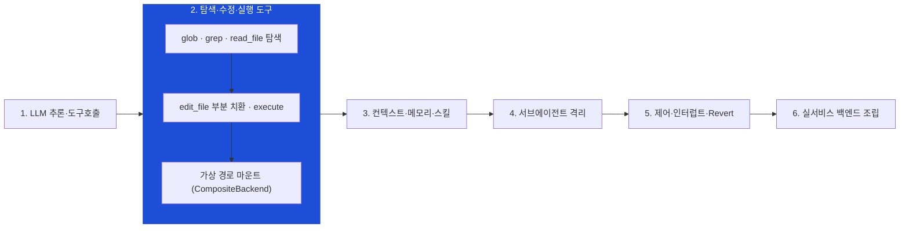

1장의 기본 루프에 무작정 "파일 읽기/쓰기" 함수만 쥐여주면 곧바로 한계에 부딪힙니다. 파일이 수백 개 있는 저장소에서 어떤 파일을 열어야 할지 모르고, 2,000줄짜리 파일을 통째로 읽고 통째로 다시 쓰다 보면 토큰이 바닥나고 기존 코드를 실수로 날려버리기 때문입니다.

그래서 현대 코딩 에이전트는 **사람 개발자가 IDE에서 코드를 찾고 고치는 동선**을 그대로 본뜬 정교한 도구 세트를 사용합니다.

### 2-1. 깔때기형 탐색 도구: `ls` → `glob` → `grep` → `read_file(offset, limit)`

에이전트가 처음 보는 저장소에서 `"할인율 계산 버그 고쳐줘"`를 처리할 때 전체 파일을 다 읽지 않고 아래 순서로 범위를 좁힙니다.

| 도구 | 역할 | 반환 데이터 특징 |
| :--- | :--- | :--- |
| **`ls(path)`** | 최상위 또는 특정 폴더의 디렉터리 구조 확인 | 폴더·파일 이름 목록만 짧게 반환 |
| **`glob(pattern)`** | 파일 이름 패턴으로 후보 파일 찾기 (예: `**/*pricing*.py`) | 일치하는 파일 경로 목록만 반환 |
| **`grep(pattern, path)`** | 정규식/키워드로 함수 정의나 에러 문자열 검색 (예: `def apply_discount`) | `파일경로:줄번호:내용` 한 줄씩만 반환 |
| **`read_file(file_path, offset, limit)`** | `grep`으로 찾은 줄 번호 전후 구간만 줄 번호와 함께 읽기 | 예: 120번째 줄부터 80줄만 로드하여 컨텍스트 절약 |

이 네 도구를 병렬(`tool_calls` 배열에 여러 개를 한 번에 요청)로 조합하면, 수만 줄 규모의 프로젝트에서도 단 몇백 토큰만으로 정확한 수정 지점을 찾아낼 수 있습니다.

### 2-2. 전체 덮어쓰기 대신 `edit_file(old_string, new_string)`을 쓰는 이유

초기 에이전트들은 파일을 고칠 때 파일 전체 내용을 다시 출력하는 `write_file`만 썼습니다. 하지만 800줄짜리 파일에서 딱 2줄만 고치려 해도 모델이 800줄을 처음부터 끝까지 다시 생성해야 하므로 응답이 수십 초씩 걸리고, 중간에 코드를 생략(`# ... 기존 코드 생략 ...`)해 파일을 망가뜨리는 사고가 잦았습니다.

이를 해결하기 위해 새 파일 생성은 `write_file`을 쓰되, 기존 파일 수정은 반드시 **정확한 원문 조각(`old_string`)과 바꿀 조각(`new_string`)만 넘기는 `edit_file`**을 사용합니다.

```json
{
  "name": "edit_file",
  "arguments": {
    "file_path": "/pricing.py",
    "old_string": "def apply_discount(price: int, rate: float) -> int:\n    return int(price * (1 - rate))",
    "new_string": "def apply_discount(price: int, rate: float) -> int:\n    if rate < 0 or rate > 1:\n        raise ValueError('rate must be between 0 and 1')\n    return int(price * (1 - rate))"
  }
}
```

이 방식에는 중요한 자체 검증 효과가 숨어 있습니다. 만약 모델이 파일을 제대로 읽지 않고 머릿속 기억만으로 `old_string`을 추측해 넘기면, 실제 파일 문자열과 일치하지 않아 백엔드가 즉시 에러를 돌려줍니다. 즉 **`edit_file`이 성공했다는 것 자체가 모델이 최신 파일 원문을 정확히 확인하고 수정했다는 증거**가 됩니다.

### 2-3. 가상 파일시스템 라우팅 (`CompositeBackend`)

코딩 에이전트는 사용자의 소스 코드만 다루지 않습니다. 구현 계획서(`implementation_plan.md`)나 작업 체크리스트(`task.md`)도 써야 하고, 프로젝트별 메모도 읽어야 하며, 내장 스킬 문서도 참고해야 합니다. 이 파일들을 사용자의 실제 Git 저장소 안에 마구 생성하면 작업 트리가 지저분해집니다.

Anvil은 `DynamicRunBackend`(`CompositeBackend` 상속, `backend/app/domains/agent/run_backends.py`)를 통해 **에이전트에게는 하나의 깔끔한 유닉스풍 가상 경로를 보여주되, 실제 디스크에서는 경로 접두사에 따라 서로 다른 물리 폴더로 분기**시킵니다.

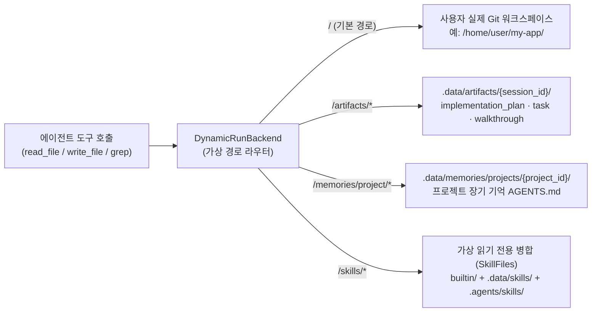

이렇게 경로를 라우팅하면 에이전트는 똑같은 `read_file`·`write_file` 도구 하나로 코드 수정, 계획서 작성, 스킬 열람을 일관되게 처리하면서도 사용자 레포지토리에는 불필요한 임시 파일을 남기지 않습니다.

---

## 3장. 컨텍스트·메모리·스킬 관리 — 길어지는 문맥 창을 다루는 최신 설계 흐름

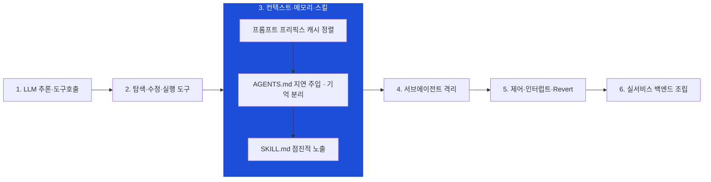

1장과 2장까지 만들면 에이전트가 제법 코드를 고치기 시작하지만, 작업이 조금만 길어져도 금세 두 가지 문제를 겪습니다.

1. **문맥 부패(Context Rot)**: `messages` 배열에 온갖 규칙 문서, 수십 개의 도구 설명서, 파일 읽기 결과가 한꺼번에 쌓이면 정작 중요한 지시사항이 파묻혀 모델이 앞선 규칙을 어기거나 엉뚱한 파일을 고칩니다.
2. **지연 시간과 비용 급증**: 매 턴 전체 `messages`를 다시 보내기 때문에 앞부분 프롬프트가 조금만 바뀌어도 LLM 서버가 이전 연산을 재사용하지 못하고 처음부터 다시 계산합니다.

클로드 코드(Claude Code)를 비롯한 최근 코딩 에이전트 아키텍처의 핵심은 바로 이 **컨텍스트 윈도우를 얼마나 아껴 쓰고 정돈하느냐(Context Engineering)**에 있습니다. Anvil에 반영한 세 가지 기법을 살펴봅니다.

### 3-1. 프롬프트 프리픽스 캐시(Prefix Cache) 정렬 (`RunPromptMiddleware`)

최신 LLM 서버들은 요청 프롬프트의 **맨 앞부분(Prefix)이 이전 요청과 글자 단위로 똑같으면**, 앞부분의 어텐션(KV Cache) 연산을 건너뛰고 새로 추가된 뒷부분만 계산합니다. 반대로 시스템 프롬프트 첫 줄에 현재 시각이나 세션 ID처럼 매번 바뀌는 값을 넣어버리면 캐시가 매번 깨집니다.

그래서 `RunPromptMiddleware`(`domains/agent/middleware/run_prompt.py`)는 시스템 프롬프트를 항상 **가장 안 바뀌는 것부터 가장 자주 바뀌는 순서**로 조립합니다.

```text
[1순위: 완전 고정] 프레임워크 기본 도구 지침 + 공통 행동 원칙 (_BASE_AGENT_GUIDANCE)
        ↓
[2순위: 모드별 고정] 실행 모드별 정책 (Ask / Plan / Auto 중 현재 모드 지침)
        ↓
[3순위: 프로젝트 고정] 루트 AGENTS.md + 프로젝트 장기 기억 (/memories/project/AGENTS.md)
        ↓
[4순위: 세션별 변동] 현재 워크스페이스 절대 경로 · 세션 ID
        ↓
[5순위: 매 턴 누적] 사용자 프롬프트 · AIMessage(tool_calls) · ToolMessage 결과들
```

이렇게 배치하면 한 세션 안에서 `while` 루프가 열 번 도는 동안 1~4순위 블록 전체가 100% 캐시에 적중하여 응답 속도와 비용 효율이 크게 좋아집니다.

### 3-2. 계층형 `AGENTS.md` 지연 주입과 2계층 기억 격리

규모가 큰 저장소에는 백엔드 규칙(`backend/AGENTS.md`)과 프론트엔드 규칙(`frontend/AGENTS.md`)이 따로 존재합니다. 백엔드 버그만 고치는데 프론트엔드 디자인 규칙 수백 줄을 처음부터 시스템 프롬프트에 다 넣어두는 것은 낭비입니다.

이를 해결하기 위해 Anvil은 두 단계로 메모리를 나누어 주입합니다.

- **루트 규칙 & 프로젝트 장기 기억 (`DynamicMemoryMiddleware`)**: 저장소 루트의 `/AGENTS.md`와 해당 프로젝트 전용 장기 기억인 `/memories/project/AGENTS.md`는 매 턴 시작(`abefore_agent`) 시 최신 디스크 본을 읽어 반영합니다. 이때 세션 단기 작업물(`/artifacts/`)과 프로젝트 장기 기억(`/memories/project/`)을 분리해, 다른 프로젝트로 전환했을 때 이전 프로젝트의 기억이 절대 섞이지 않도록 격리합니다.
- **하위 폴더 규칙 지연 주입 (`SubdirAgentsReadMiddleware`)**: 하위 디렉터리의 `AGENTS.md`는 미리 읽지 않습니다. 대신 에이전트가 작업 도중 `read_file("/frontend/src/App.tsx")`를 호출하는 바로 그 순간, 미들웨어가 상위 경로들을 거슬러 올라가며 아직 이 세션에서 보여준 적 없는 `/frontend/AGENTS.md`를 찾아 도구 결과(`ToolMessage`)에 딱 한 번만 덧붙여 줍니다. 에이전트가 건드리는 영역의 규칙만 필요한 순간에 컨텍스트로 들어오는 구조입니다.

### 3-3. 도구 비대화(Tool Bloat) 방지와 `SKILL.md` 점진적 노출 (Progressive Disclosure)

에이전트에게 코드 온보딩, 테스트 검증, 보안 점검, UI 감사 같은 전문 기능을 가르치고 싶을 때 흔히 저지르는 실수가 기능마다 전용 도구(`run_onboarding_tool`, `run_security_audit_tool` 등)를 수십 개씩 추가하는 것입니다. 도구가 40개로 늘어나면 모델은 매 턴 아무 일도 하기 전에 40개 도구의 JSON 스키마 수천 토큰을 읽어야 하고, 비슷한 도구들 사이에서 선택 실수를 하기 시작합니다.

클로드 코드와 `skills.sh` 생태계가 정립한 해법은 **코어 도구는 최소한(9개: `ls`, `read_file`, `write_file`, `edit_file`, `glob`, `grep`, `execute`, `ask_user`, `task`)으로 고정하고, 전문 작업 절차는 `/skills/<이름>/SKILL.md` 문서로 분리하는 점진적 노출(Progressive Disclosure)**입니다.

1. 평소 시스템 프롬프트에는 설치된 스킬들의 **이름과 1줄 설명(목차)**만 가볍게 들어갑니다.
2. 사용자가 특정 작업을 요청하거나 `/verify`처럼 스킬을 지정하면, 그제서야 에이전트가 스스로 `read_file("/skills/verify/SKILL.md")`를 호출해 상세 지침을 컨텍스트로 불러옵니다.
3. 쓰지 않는 수십 개 스킬의 본문은 평소 컨텍스트를 1토큰도 차지하지 않습니다.

---

## 4장. 서브에이전트 문맥 격리 — 왜 탐색과 코드 리뷰를 별도 에이전트로 떼어내는가

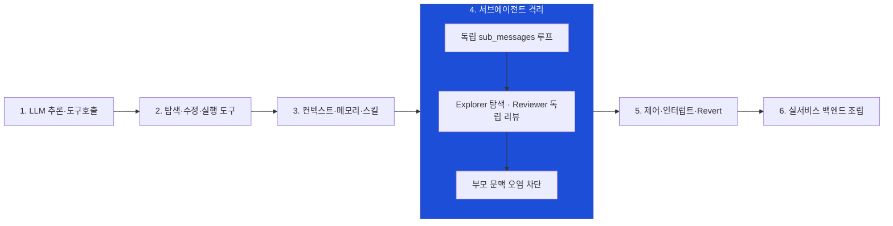

3장의 기법들로 프롬프트를 정리하더라도, 에이전트가 복잡한 원인을 찾기 위해 파일 20개를 연달아 `grep`하고 `read_file`하면 메인 `messages` 배열에는 금세 수만 토큰의 날것 코드 조각이 쌓입니다. 정작 원인을 다 찾고 코드를 고칠 때가 되면 앞선 탐색 쓰레기 데이터가 컨텍스트의 절반 이상을 차지하게 됩니다.

또한 한 에이전트가 직접 코드를 짜고 곧바로 *"내 코드에 문제가 없는지 검토해 보겠습니다"*라며 스스로 리뷰하면, 자신이 방금 세운 가정에 갇혀 버그를 놓치는 **자기 확증 편향**이 발생합니다.

### 4-1. 독립 `sub_messages` 루프로 동작하는 `task` 도구

서브에이전트는 거창한 외부 서버가 아닙니다. 메인 에이전트가 `task(subagent_type="explorer", description="...")` 도구를 호출하면, 백엔드 안에서 **부모의 `messages` 기록을 물려받지 않는 완전히 새로운 빈 `sub_messages` 배열과 별도의 작은 에이전트 루프**가 하나 생성됩니다.

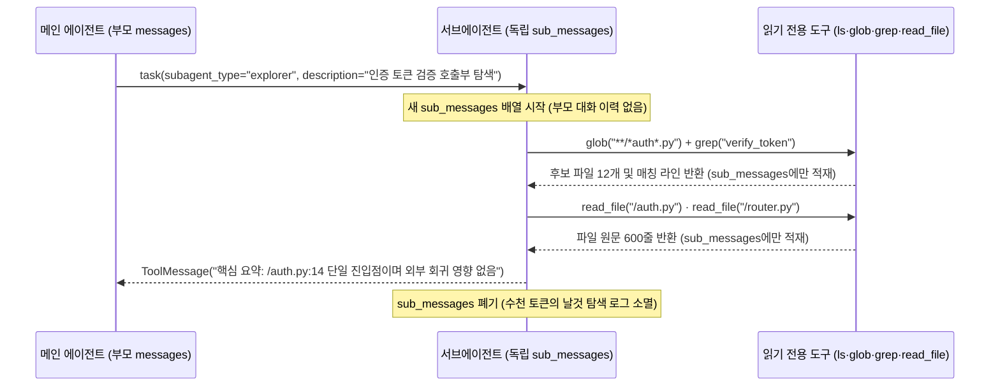

위 흐름에서 보듯 서브에이전트가 읽어들인 600줄의 원문과 12번의 시행착오는 `sub_messages` 안에서만 소비되고 작업이 끝나는 즉시 버려집니다. 부모 에이전트의 `messages` 배열에는 오직 깔끔하게 압축된 `ToolMessage` 요약 몇 줄만 추가됩니다.

### 4-2. `Explorer`와 `Code Reviewer`의 역할 분리와 실행 추적

Anvil은 두 종류의 전용 서브에이전트(`domains/agent/subagents.py`)를 운용하며, 두 서브에이전트 모두 `ReadOnlyToolGuardMiddleware`를 씌워 **파일 수정이나 셸 실행 도구를 물리적으로 제거한 읽기 전용 환경**에서만 돌아가게 강제합니다.

- **`Explorer` (고속 코드베이스 탐색기)**: 넓은 범위의 호출 관계 파악이나 의존성 매핑을 맡아 핵심 파일 경로와 줄 번호만 추려 부모에게 보고합니다.
- **`Code Reviewer` (독립 코드 리뷰어)**: 메인 에이전트가 수정을 마친 뒤 변경분(`git diff` 및 수정 파일)을 **작성 과정의 편향 없이 백지상태에서** 읽고 `[Important]`(반드시 고쳐야 할 결함), `[Nit]`(사소한 개선), `[Pre-existing]`(기존 코드 이슈) 등급으로 냉정하게 판정합니다.

이때 서브에이전트 내부에서 어떤 파일을 읽고 검색했는지 블랙박스가 되지 않도록, 백엔드 하네스(`harness.py`)는 스트리밍 이벤트의 `lc_subagent_tool_call_id`와 `lc_agent_name` 메타데이터를 읽어 각 하위 도구 호출을 부모 `task` ID(`parent_id`) 밑으로 정확히 묶어 내려보냅니다. 덕분에 사용자는 평소에는 한 줄 요약 카드로 깔끔하게 보다가, 필요할 때만 카드를 펼쳐 서브에이전트가 실제로 읽은 파일 목록과 리뷰 리포트를 확인할 수 있습니다.

---

## 5장. 제어·인터럽트·Revert — 에이전트가 사고 치지 않고 언제든 되돌아오는 원리

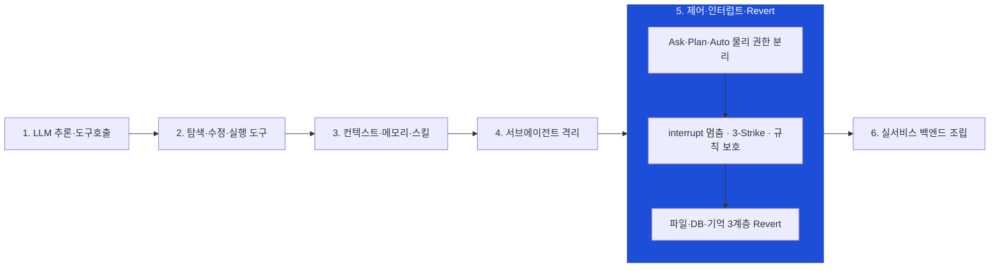

자율적으로 셸 명령을 치고 파일을 고치는 에이전트를 실무에 쓰려면 세 가지 질문에 답해야 합니다. **"위험한 명령은 어떻게 막는가?"**, **"사람에게 물어봐야 할 때 실행 중인 루프를 어떻게 멈췄다 다시 잇는가?"**, **"에이전트가 코드를 망쳤을 때 어떻게 감쪽같이 되돌리는가?"**입니다.

### 5-1. 3단계 실행 모드 물리 분리와 실용적 `ShellGuard`

프롬프트에 *"절대 파일을 지우지 마세요"*라고 적는 것은 보안 장치가 아닙니다. Anvil은 실행 모드(`Ask` / `Plan` / `Auto`)에 따라 아예 백엔드 권한과 노출 도구를 물리적으로 다르게 조립합니다.

- **`Ask` 모드**: 셸 실행(`execute`) 도구가 없는 읽기 전용 `FilesystemBackend`를 마운트하고 `/artifacts/` 외 모든 쓰기를 차단합니다.
- **`Plan` 모드**: 먼저 요구사항을 확인하고 `/artifacts/implementation_plan.md`를 작성한 뒤 그래프를 일시 정지시켜 사용자의 승인(`Proceed`)을 받기 전까지는 워크스페이스 수정을 미들웨어에서 거부합니다.
- **`Auto` 모드 및 실용적 `ShellGuard`(`domains/agent/shell_guard.py`)**: 모든 `pytest`, `git status`, `ruff` 명령마다 승인 창을 띄우면 사람이 피로해져 개발이 진행되지 않습니다. 그래서 `ShellGuard`는 시스템 파괴 패턴(`rm -rf /`, 포크 폭탄 등)은 즉시 영구 차단(`BLOCK`)하고, 일반 개발·검증 명령은 자동 허용(`ALLOW`)하되, **`rm`, `git push`, `git reset --hard`, `git clean`, `git checkout --`처럼 되돌리기 어려운 파괴적 명령일 때만 정확히 골라 사용자 승인(`REQUIRE_APPROVAL`)을 요청**합니다.

### 5-2. 단순 `while`문 대신 LangGraph `interrupt()`를 쓰는 결정적 이유

1장에서 본 단순 `while`문 안에서는 에이전트가 사용자에게 *"할인율 정책을 A안으로 할까요, B안으로 할까요?"*(`ask_user`) 혹은 *"이 `rm` 명령을 실행할까요?"*(`shell_approval`)라고 물어야 할 때 HTTP 요청을 수십 분 동안 열어둔 채 기다릴 수 없습니다.

LangGraph의 상태 그래프(`StateGraph`)와 체크포인터(`AsyncSqliteSaver`)는 각 노드 실행 직후의 전체 변수 상태(`messages`, `todos`, `plan_approved`)를 SQLite에 직렬화해 저장합니다.

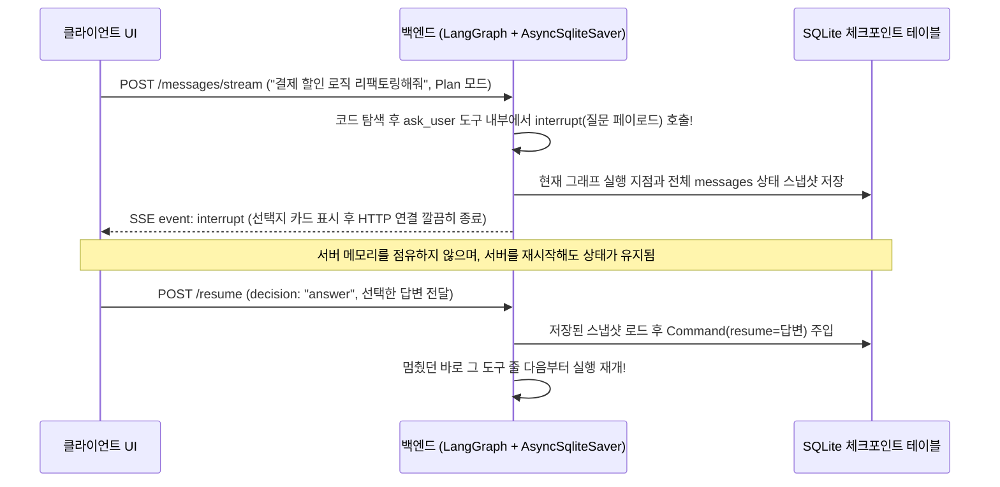

도구 함수나 미들웨어 안에서 `decision = interrupt({...})` 한 줄을 호출하면, LangGraph가 특수 예외를 발생시켜 그 시점의 콜스택 상태를 SQLite에 얼려 두고 스트림을 안전하게 닫습니다. 이후 사용자가 버튼을 눌러 `POST /resume`을 호출하면 `Command(resume=...)` 값이 아까 멈췄던 `interrupt(...)`의 반환값 `decision` 자리로 쏙 들어가며 그 다음 줄부터 실행이 이어집니다.

### 5-3. 자율 검증 3-Strike 규칙과 '검증 기준 자기수정 금지'

에이전트가 코드를 수정한 뒤 스스로 테스트를 돌려 검증하게 할 때는 두 가지 안전장치가 필수입니다(`VerificationLoopMiddleware`, `ArtifactWorkflowMiddleware`).

1. **Three-Strike 중단 규칙**: 테스트가 실패했을 때 스스로 고치는 루프를 허용하되, **연속 3번 검증 명령이 실패하면** 에이전트가 엉뚱한 방향으로 코드를 계속 덧칠하지 못하도록 수정을 멈추고 지금까지 확인된 실패 원인과 로그를 사용자에게 보고하도록 유도합니다. 또한 테스트 통과(`passed`) 직후 다시 파일을 건드리면 기존 통과 스탬프를 즉시 무효화해 재검증을 강제합니다.
2. **검증 기준 보호 (*"Changes can't modify their own checks"*)**: 에이전트가 아키텍처 테스트나 린트를 통과시키기 위해 아예 `test_architecture_boundaries.py`, `.github/workflows/*`, `AGENTS.md` 같은 **심판 규칙 파일 자체를 느슨하게 고쳐버리는 반칙**을 막기 위해, 해당 경로(`ShellGuard.is_verifier_rule_path`)에 대한 쓰기 시도는 `Auto` 모드라도 무조건 사용자 승인 인터럽트를 걸어 차단합니다.

### 5-4. 무커밋 상태에서도 완벽히 되감는 '3계층 동기화 Revert'

실제로 코딩 에이전트를 써보면 *"턴 1에서 만든 기능은 마음에 드는데(아직 `git commit` 전), 방금 턴 2에서 시도한 리팩토링이 꼬여서 턴 2만 없던 일로 되돌리고 싶다"*는 상황이 매우 자주 생깁니다. 이때 단순 `git checkout -- .`을 실행하면 아직 커밋하지 않은 턴 1의 성공한 코드까지 전부 날아갑니다.

더 큰 함정은 **디스크의 파일만 옛날 상태로 돌려놓으면, LLM의 대화 기억(`AsyncSqliteSaver`) 속에는 여전히 "내가 방금 `v2`로 고쳤다"는 기록이 남아 있어 다음 턴에 존재하지도 않는 코드를 기준으로 대답하는 심각한 환각(Hallucination)이 터진다**는 점입니다.

그래서 Anvil의 `Revert`(`SessionService.revert_from_message` + `TurnCheckpointStore`)는 반드시 **세 계층을 동시에 되감습니다.**

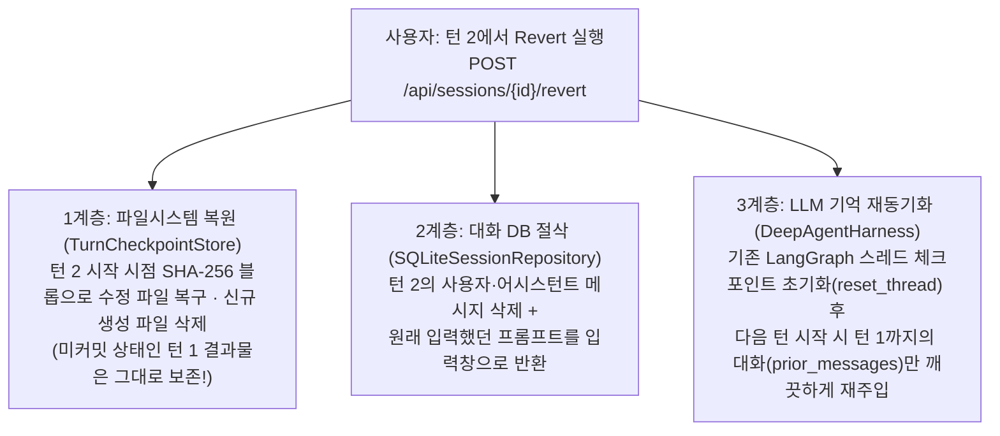

이때 `TurnCheckpointStore`(`domains/agent/checkpoints.py`)는 각 파일 내용을 SHA-256 해시 이름의 블롭(`.data/checkpoints/{session_id}/blobs/<sha256>`)으로 중복 없이 저장하고, 턴 종료 시 실제로 바뀐 파일 목록만 매니페스트 JSON으로 기록합니다. 스캔 속도를 높이기 위해 `(mtime_ns, ctime_ns, size, ino)` 4종 스탬프가 같고 수정 시각이 스냅샷 시작보다 2초 이상 과거인 파일은 재해싱을 건너뛰되, 2초 이내의 동일 크기 수정(Racy-Git 조건)은 빠짐없이 해싱해 복구 누락을 원천 방지합니다.

---

## 6장. 실서비스 백엔드 조립 — 멀티세션 격리, 미들웨어 체인, DDD 경계

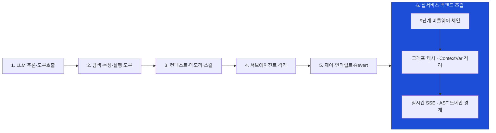

마지막 6단계는 지금까지 만든 부품들을 여러 프로젝트와 여러 세션이 동시에 접속하는 단일 웹 서버 프로세스 안에서 안전하고 유지보수 가능하게 조립하는 백엔드 엔지니어링입니다.

### 6-1. 9단계 미들웨어 파이프라인의 정밀한 순서

`DeepAgentHarness`(`domains/agent/harness.py`)는 앞서 살펴본 기능들을 거대한 단일 함수에 뒤섞지 않고, 모델 호출(`awrap_model_call`)과 도구 호출(`awrap_tool_call`), 턴 전후(`abefore_agent` · `aafter_agent`)를 양파껍질처럼 감싸는 **9개의 독립 미들웨어 체인**으로 조립합니다.

1. **`TodoListMiddleware`**: 에이전트의 작업 진행 체크리스트(`write_todos`) 상태 관리
2. **`RunPromptMiddleware`**: 프롬프트 프리픽스 캐시 적중률을 끌어올리는 정적 → 동적 시스템 프롬프트 조립
3. **`DynamicMemoryMiddleware`**: 매 턴 루트 `/AGENTS.md` 및 프로젝트 장기 기억 최신본 로드
4. **`SubdirAgentsReadMiddleware`**: 하위 폴더 파일 열람 시 해당 경로의 `AGENTS.md` 지연 주입
5. **`ToolErrorMiddleware`**: 파일 경로 오타 등 일반 도구 에러는 모델이 스스로 고쳐 재시도할 수 있도록 구조화된 `ToolMessage`로 변환하되, **LangGraph `interrupt()`(`GraphBubbleUp`)와 스트림 취소(`CancelledError`)는 절대 삼키지 않고 즉시 상위로 전파**
6. **`ModelRetryMiddleware`**: 일시적인 네트워크 타임아웃에 대한 짧은 백오프 재시도
7. **`GitEvidenceMiddleware`**: 턴 시작 전 파일 스냅샷 베이스라인 캡처 및 수정 도구 실행 직후 단일 프로세스(`git status --porcelain=v2 --branch -z`)로 Git 변경 상태 추적
8. **`VerificationLoopMiddleware`**: 코드 변경 대비 테스트 실행 결과 감시 및 3-Strike 중단 가이드 주입
9. **`ArtifactWorkflowMiddleware`**: `Plan` 승인 전 수정 차단, 검증 규칙 파일 보호, `plan_review` · `shell_approval` 인터럽트 제어

### 6-2. 그래프 LRU 캐시 공유와 `ContextVar` 실행 격리

`create_deep_agent`로 미들웨어와 도구 스키마가 묶인 LangGraph를 컴파일하는 작업은 매 요청마다 반복하기엔 무겁습니다. 그렇다고 그래프 인스턴스를 전역 캐시(`_graphs` LRU 캐시)에 넣어 여러 세션이 함께 쓰게 만들면, 세션 A와 세션 B가 서로 다른 폴더(`workspace_path`)를 바라볼 때 경로가 뒤섞일 위험이 생깁니다.

Anvil은 **컴파일된 그래프 구조체는 `(모델 설정 지문, 실행 모드)` 키로 LRU 캐시에서 재사용**하고, 실행 순간마다 달라지는 세션 ID·워크스페이스 경로·아티팩트 폴더·시크릿 목록은 불변 데이터 객체인 `RunCatalog`에 담아 **Python 표준 비동기 문맥 변수(`contextvars.ContextVar`, `RunContext`)**에 바인딩합니다.

```python
# 그래프 자체는 캐시에서 꺼내 재사용하지만, 실행 문맥은 비동기 태스크별로 완전 격리됩니다.
async with RunContext.activate(catalog):
    async for item in graph.astream(graph_input, config={"configurable": {"thread_id": session_id}}):
        ...
```

`DynamicRunBackend`와 모든 미들웨어는 자기 인스턴스 변수가 아니라 `RunContext.current()`에서 현재 비동기 코루틴의 `RunCatalog`를 꺼내 쓰므로, 동시에 여러 세션이 돌아가도 상태가 절대 섞이지 않습니다. 또한 같은 세션에 중복 스트림 요청이 동시에 들어오는 것은 라우터 사전 검증(`Depends`) 단계의 인메모리 활성 셋으로 즉시 차단(`409 SESSION_RUNNING`)합니다.

### 6-3. 클라이언트 취소(`Abort`) 보호와 보안·DDD 아키텍처 경계

- **스트림 중단 시 데이터 유실 방지 (`asyncio.shield`)**: 사용자가 실행 도중 `Stop` 버튼을 누르거나 다른 프로젝트로 화면을 전환하면 클라이언트가 SSE 연결을 끊어 `CancelledError`/`GeneratorExit`가 발생합니다. 이때 `SessionService._consume_and_persist_stream`은 `finally` 블록을 `asyncio.shield`로 감싸, 지금까지 생성된 토큰·도구 이력과 중단 직전까지 수정된 파일들의 스냅샷 매니페스트(`finalize_pending_capture`)를 끝까지 SQLite와 디스크에 기록합니다. 덕분에 중간에 멈춘 턴도 언제든 깨끗하게 `Revert`할 수 있습니다.
- **무저장(Zero-Persistence) API 키 보안**: LLM 엔드포인트 URL과 API 키는 브라우저에만 보관하고 매 요청 `X-LLM-*` 헤더로만 전달받습니다. 서버 DB나 체크포인트에는 절대 저장하지 않으며, 모든 백엔드 로그는 표준 라이브러리 기반 `SecretRedactionFilter`를 통과시켜 키 노출을 원천 차단합니다.
- **문서가 아닌 AST 테스트로 강제하는 DDD 경계**: 백엔드를 `sessions`, `agent`, `artifacts`, `skills` 4개 도메인과 `shared`로 나누고, `tests/test_architecture_boundaries.py`에서 파이썬 `ast` 모듈로 모든 파일의 `import` 구문을 정적 검사합니다. 예를 들어 `agent` 도메인이 `sessions` 도메인을 참조하거나 `artifacts` 도메인이 `langgraph`를 참조하면 즉시 테스트가 깨지도록 만들어 코드 규모가 커져도 결합도가 높아지지 않게 지켰습니다.
- *(참고: 프론트엔드 연결 원칙)* 화면 계층은 백엔드가 보내주는 원본 SSE 이벤트와 메시지 배열을 변형 없이 그대로 보존하고, 렌더링 직전 순수 함수 셀렉터로만 연속 탐색 묶음(`ExplorationGroup`)이나 서브에이전트 카드를 파생 계산합니다. UI 요소는 커스텀 CSS 없이 `@astryxdesign/core` 컴포넌트 조합만으로 간결하게 구성했습니다.

---

## 7장. Lessons Learned — 코딩 에이전트를 직접 구현하며 배운 7가지 핵심 교훈

처음 코딩 에이전트를 구상할 때 가졌던 막연한 생각과, 실제로 부딪히고 디버깅하며 체득한 설계 원리를 마지막으로 정리합니다.

### 1. 프롬프트로 타이르지 말고 물리적 실행 환경을 분리해야 합니다
- **초기 생각**: 시스템 프롬프트에 *"Ask 모드에서는 절대 파일을 수정하거나 셸을 실행하지 마라"*고 강조하면 될 것이라 생각했습니다.
- **실제 배운 점**: 컨텍스트가 길어지면 모델은 프롬프트 제약을 종종 어깁니다. 읽기 전용 모드에서는 아예 `execute` 도구가 없는 `FilesystemBackend`를 마운트하고, 검증 규칙 파일(`AGENTS.md`, 경계 테스트)은 미들웨어에서 물리적으로 쓰기 승인을 걸어야 100% 신뢰할 수 있는 에이전트가 됩니다.

### 2. 승인 창을 남발하면 안전해지는 것이 아니라 에이전트를 안 쓰게 됩니다
- **초기 생각**: 안전을 위해 모든 셸 명령 실행마다 사용자에게 승인 버튼을 누르게 했습니다.
- **실제 배운 점**: `pytest`나 `ruff`를 돌릴 때마다 흐름이 끊기니 자율 코딩의 의미가 사라지고 사용자가 내용을 읽지도 않은 채 승인 버튼을 연타하게 됩니다. 안전한 읽기·검증 명령은 즉시 통과시키고, `rm`·`git push`·`git reset --hard`처럼 되돌리기 힘든 파괴적 명령에서만 멈추게 했을 때 개발 속도와 실질적 안전성을 모두 얻을 수 있었습니다.

### 3. 도구를 늘릴수록 에이전트는 둔해지며, 해답은 점진적 노출(`SKILL.md`)에 있습니다
- **초기 생각**: 새 기능이 필요할 때마다 전용 함수(Tool)를 계속 추가하려 했습니다.
- **실제 배운 점**: 도구 스키마는 매 턴 숨만 쉬어도 소모되는 고정 컨텍스트 세금입니다. 코어 도구는 9개로 얇게 유지하고, 복잡한 절차 지식은 필요할 때만 `read_file`로 펼쳐 보는 `SKILL.md` 구조로 옮겼을 때 토큰 효율과 도구 선택 정확도가 눈에 띄게 올라갔습니다.

### 4. 대량 탐색과 코드 리뷰는 반드시 독립된 서브에이전트 문맥으로 격리해야 합니다
- **초기 생각**: 메인 에이전트 하나로 탐색, 구현, 최종 코드 리뷰까지 한 스레드에서 이어가려 했습니다.
- **실제 배운 점**: 탐색 과정에서 읽은 수천 줄의 파일 내용이 메인 문맥을 오염시키고, 자기가 짠 코드는 스스로 관대하게 평가합니다. 별도의 빈 `sub_messages`에서 도는 `Explorer`와 `Code Reviewer`로 분리해 요약만 돌려받는 구조가 문맥 경제성과 리뷰 품질 양쪽에서 결정적이었습니다.

### 5. 일반 에러는 모델에게 돌려주고, 제어 신호(인터럽트·취소)는 절대 삼키면 안 됩니다
- **초기 생각**: 도구 실행 중 예외가 나면 무조건 `try / except Exception`으로 잡아 에러 문자열로 바꾸면 안전할 것이라 여겼습니다.
- **실제 배운 점**: 파일 오타나 치환 실패는 `ToolMessage`로 돌려줘야 모델이 스스로 고치지만, LangGraph의 `interrupt()` 예외나 비동기 취소(`CancelledError` · `GeneratorExit`)까지 잡아 삼켜버리면 승인 대기와 스트림 중단이 완전히 망가집니다. 복구 가능한 도메인 오류와 런타임 제어 신호를 엄격히 구분해 전파하는 것이 상태 머신 구현의 핵심이었습니다.

### 6. 코딩 에이전트의 Revert는 파일만 돌리면 오히려 환각을 부릅니다
- **초기 생각**: 되돌리기 기능은 디스크의 소스 파일만 이전 상태로 복구하면 끝이라고 생각했습니다.
- **실제 배운 점**: 디스크 파일만 되돌리고 체크포인터 속 대화 기억을 그대로 두면, 모델은 자기가 고쳤던 코드가 아직 있는 줄 알고 다음 턴에 완전히 꼬인 수정을 시도합니다. **SHA-256 파일 스냅샷 복원 + SQLite 대화 절삭 + LangGraph 스레드 재주입(`prior_messages`)** 세 계층을 한 묶음으로 맞춰야 비로소 실전에서 쓸 수 있는 Revert가 완성됩니다.

### 7. 아키텍처 원칙은 문서가 아니라 자동화된 테스트로 걸어 잠가야 유지됩니다
- **초기 생각**: 문서에 도메인 분리 규칙을 적어두면 자연히 지켜질 것이라 생각했습니다.
- **실제 배운 점**: 기능을 빠르게 덧붙이다 보면 편의를 위해 도메인 간 직접 참조 유혹이 끊임없이 생깁니다. `ast` 모듈로 `import` 경계를 검사하는 단위 테스트(`test_architecture_boundaries.py`)와 무작위 파일 수정·복원 일치성을 검증하는 불변식 테스트를 둔 덕분에, 수차례의 큰 구조 변경 속에서도 회귀 없이 깔끔한 배선을 끝까지 유지할 수 있었습니다.
