# 코딩 에이전트 구현 Review

텍스트만 입출력하던 LLM이 로컬 저장소에서 에러 원인을 검색(`grep`)하고, 파일을 읽고 수정하며(`read_file` · `edit_file`), 테스트를 실행해 검증(`execute`)하고, 잘못된 변경을 되돌리는(`Revert`) **코딩 에이전트**로 동작하기까지의 내부 구조와 구현 원리를 정리한 문서입니다.

**`"테스트 에러 원인 찾아 고쳐줘"`**라는 실제 디버깅 요청이 JSON 페이로드와 파이썬 코드 레벨에서 어떻게 처리되는지 따라가며, 어떤 기능을 프레임워크(`LangGraph` · `LangChain` · `deepagents`)에서 가져다 썼고 무엇을 직접 구현했는지 구분해 설명합니다.

---

## 구현 배경 및 학습 목표

일반 챗봇이나 정해진 순서대로 흐르는 파이프라인(RAG[^1] · 고정 워크플로우)과 달리, 코딩 에이전트는 **파일시스템을 직접 변경하고 OS 프로세스를 실행하며 작은 실수도 즉시 문법 에러나 런타임 실패로 되돌아오는 환경**에서 동작합니다. 자율 에이전트 시스템의 핵심 난제가 한곳에 모여 있어, 이번 구현에서는 아래 엔지니어링 주제들을 직접 부딪히며 익히는 것을 목표로 삼았습니다.

- **Context Engineering과 점진적 탐색 (`Progressive Disclosure`)**
  - 수만 줄짜리 코드베이스를 프롬프트에 통째로 넣을 수 없으므로, 디렉터리 확인(`ls`) → 키워드 검색(`grep`) → 필요한 라인 구간 읽기(`read_file`) 순으로 최소 토큰만 쓰며 맥락을 좁혀 가는 구조를 설계합니다.
  - 시스템 프롬프트 앞단을 고정해 `Prompt Prefix Caching`[^2] 적중률을 유지하고, 대량 파일 열람은 독립된 `Subagent` 루프로 격리해 메인 대화의 문맥 오염(`Context Rot`)을 막습니다.
- **에이전트 친화적 도구 설계 (`ACI: Agent-Computer Interface`)**[^3]
  - 파일 전체를 덮어쓰게(`write_file`) 두면 토큰 낭비와 코드 유실이 발생하고, 줄 번호 기반 수정은 번호가 밀리며 깨집니다. 고유 문자열 매칭 기반의 부분 치환(`edit_file`) 도구를 두고, 실패 시 프로세스를 중단하는 대신 모델이 다음 턴에 스스로 인자를 고쳐 재시도(`Self-Healing`)할 수 있도록 에러 피드백(`ToolMessage`)을 설계합니다.
- **동적 상태 머신 · 실행 격리 · 일관성 복구 (`Suspend / Resume` & `Revert`)**
  - 정해진 단방향 그래프가 아니라 조건에 따라 분기하고 멈췄다 다시 도는 자율 루프를 제어합니다. 동일 실패 반복을 끊는 `3-Strike` 가드레일, 위험 명령 직전 상태를 직렬화해 멈췄다 이어 달리는 `Human-in-the-Loop`(`interrupt()`), 상위 디렉터리 침범(`Path Traversal`)[^4] 방어와 서브프로세스 타임아웃 격리, 그리고 잘못된 턴을 파일·DB·그래프 기억까지 함께 되감는 `Revert`를 구현합니다.

| 영역 | 일반 챗봇 · 고정 파이프라인(RAG) | 코딩 에이전트 직접 구현 |
| :--- | :--- | :--- |
| **컨텍스트** | 검색된 고정 청크를 일회성으로 주입 | 능동 탐색(`Progressive Disclosure`) + `Prefix Cache` 정렬 + `Subagent` 격리 |
| **도구 (`ACI`)** | 조회 위주의 단순 API 래핑 | 고유 문자열 부분 치환(`edit_file`) + 자가 교정을 유도하는 에러 `ToolMessage` |
| **제어 흐름** | 정해진 순서대로 흐르는 고정 그래프 | 자율 루프, 무한 반복 차단(`3-Strike`), 승인 대기(`Suspend / Resume`) |
| **검증 · 복구** | 프롬프트 기반 자체 평가에 의존 | `pytest`·린터 등 결정론적 실행 검증 + 파일·DB·체크포인터 동기화 `Revert` |

결국 여기서 다룬 `파일`과 `터미널` 자리에 사내 문서, 데이터베이스, 내부 API만 갈아 끼우면 다른 도메인의 자율 에이전트도 동일한 아키텍처 원칙 위에서 설계할 수 있습니다.

---

## Architecture Overview

### Runtime Topology

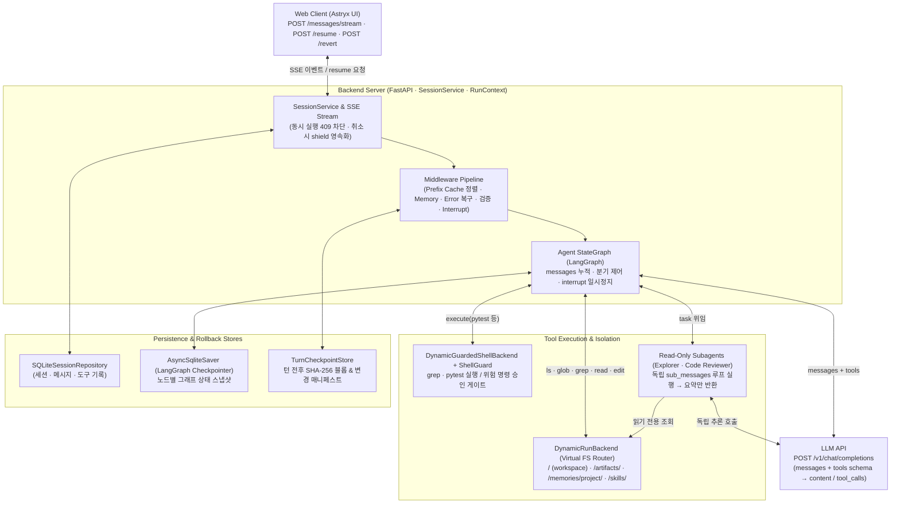

### Architecture Pipeline

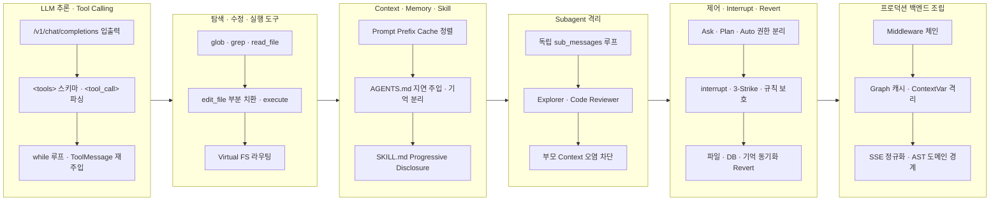

### 프레임워크 기본 제공 vs 직접 구현 범위

코드 설명에 앞서 외부 라이브러리가 제공하는 기반 기능과 이 프로젝트에서 직접 작성한 영역을 구분하면 아래와 같습니다.

| 영역 | `LangGraph` / `LangChain` / `deepagents` 제공 | 직접 구현 (Custom) |
| :--- | :--- | :--- |
| **모델 호출** | `ChatOpenAI` 기본 클라이언트 | `ReasoningChatOpenAI` (`reasoning_content` 파싱 · 미지원 옵션 폴백), `ModelFactory` (공용 `httpx` 풀 관리) |
| **파일 · 셸 도구** | `ls`, `glob`, `grep`, `read_file`, `write_file`, `edit_file`, `execute` 도구 스키마 및 정적 `CompositeBackend` · `LocalShellBackend` | 요청별 `ContextVar`[^5]로 경로를 동적 바인딩하는 `DynamicRunBackend` · `DynamicGuardedShellBackend`, 위험 명령 판정기 `ShellGuard`, 멀티 스코프 스킬 병합기 `SkillFiles` |
| **컨텍스트 · 메모리** | `AgentMiddleware` 훅 인터페이스, `TodoListMiddleware`, 기본 `MemoryMiddleware` | `RunPromptMiddleware` (Prefix Cache 순서 조립), `DynamicMemoryMiddleware` (매 턴 디스크 재로드 확장), `SubdirAgentsReadMiddleware` (하위 폴더 규칙 지연 주입), 내장 `SKILL.md` 및 `skills.sh` 설치기 |
| **서브에이전트** | `task` 도구 실행 메커니즘 | `explorer` · `reviewer` 프롬프트/스펙 정의, `ReadOnlyToolGuardMiddleware` (쓰기 원천 차단), `lc_subagent_tool_call_id` 부모-자식 스트림 매핑 |
| **제어 · 복구** | `StateGraph`, `AsyncSqliteSaver` 체크포인터, `interrupt()` / `Command(resume=...)` 프리미티브 | `ask_user` 질문 도구, `VerificationLoopMiddleware` (3-Strike · 스탬프 관리), `ArtifactWorkflowMiddleware` (`Plan` 승인 · 검증 규칙 파일 보호), `TurnCheckpointStore` (SHA-256 파일 스냅샷) 및 파일·DB·기억 동기화 `Revert` |

---

## 1. LLM 추론과 Tool Calling 루프

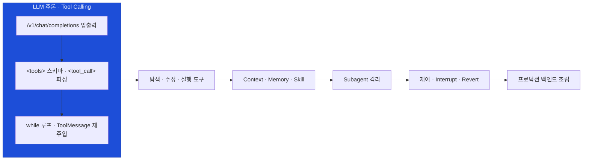

LLM API는 두 가지 근본 제약을 가집니다.
- 이전 요청을 기억하지 못하는 **Stateless**[^6] HTTP 함수입니다.
- 로컬 파일을 열거나 터미널 명령을 직접 실행할 수 없고, 오직 토큰을 입력받아 다음 토큰만 생성합니다.

이 제약을 넘어 `"테스트 에러 원인 찾아 고쳐줘"`를 수행하게 만드는 핵심 장치가 HTTP 요청의 `tools` 스키마와 백엔드의 `while` 루프입니다.

### 1-1. `/v1/chat/completions` 요청과 `<tools>` / `<tool_call>`

백엔드가 LLM 엔드포인트(`POST /v1/chat/completions`)를 호출할 때 대화 내역(`messages`)과 함께 백엔드가 실행 가능한 함수 명세(`tools` JSON Schema[^7])를 전달합니다.

```json
{
  "model": "qwen3.8-flash",
  "messages": [
    { "role": "system", "content": "You are a concise coding agent." },
    { "role": "user", "content": "테스트 에러 원인 찾아 고쳐줘" }
  ],
  "tools": [
    {
      "type": "function",
      "function": {
        "name": "execute",
        "description": "워크스페이스에서 셸 명령을 실행합니다.",
        "parameters": {
          "type": "object",
          "properties": { "command": { "type": "string" } },
          "required": ["command"]
        }
      }
    },
    {
      "type": "function",
      "function": {
        "name": "read_file",
        "description": "파일의 지정 줄 범위를 읽습니다.",
        "parameters": {
          "type": "object",
          "properties": {
            "file_path": { "type": "string" },
            "offset": { "type": "integer" },
            "limit": { "type": "integer" }
          },
          "required": ["file_path"]
        }
      }
    }
  ]
}
```

추론 서버(vLLM, OpenAI 호환 서버 등)는 `tools` 배열을 모델 프롬프트 내부의 `<tools>...</tools>` 블록으로 변환해 주입합니다. 모델이 테스트 실행이 먼저 필요하다고 판단하면 일반 답변 대신 `<tool_call>{"name": "execute", "arguments": {"command": "pytest -q"}}</tool_call>` 토큰을 출력하고, 추론 서버가 이를 파싱해 아래 JSON으로 반환합니다.

```json
{
  "choices": [
    {
      "finish_reason": "tool_calls",
      "message": {
        "role": "assistant",
        "content": "",
        "reasoning_content": "먼저 pytest를 실행해 실패하는 테스트를 확인합니다.",
        "tool_calls": [
          {
            "id": "call_01",
            "type": "function",
            "function": {
              "name": "execute",
              "arguments": "{\"command\": \"pytest -q\"}"
            }
          }
        ]
      }
    }
  ]
}
```

> **구현 구분**: 기본 `ChatOpenAI`(LangChain 제공)는 표준 `tool_calls`만 파싱하고 오픈소스 추론 모델이 내려주는 `reasoning_content` 필드는 버리는 경우가 있어, 이를 스트리밍 청크 단위로 추출하는 `ReasoningChatOpenAI`(`domains/agent/model_adapter.py`)는 직접 상속해 구현했습니다.

### 1-2. `while` 루프와 `ToolMessage` 재주입

모델이 `tool_calls`를 반환하면 백엔드가 실제 함수를 실행한 뒤, 그 출력을 `role: "tool"` 메시지(`ToolMessage`)로 감싸 `messages` 배열 끝에 붙이고 LLM을 다시 호출합니다.

```python
messages = [
    {"role": "system", "content": SYSTEM_PROMPT},
    {"role": "user", "content": "테스트 에러 원인 찾아 고쳐줘"},
]

while True:
    # 누적된 messages 전체를 매번 LLM에 다시 보냅니다.
    assistant_msg = await call_llm(messages=messages, tools=TOOL_SCHEMAS)
    messages.append(assistant_msg)

    # tool_calls가 비어 있으면 최종 답변이므로 루프를 종료합니다.
    if not assistant_msg.get("tool_calls"):
        print(assistant_msg["content"])
        break

    # 요청받은 도구를 실행하고 결과를 같은 tool_call_id로 묶어 추가합니다.
    for tool_call in assistant_msg["tool_calls"]:
        result_text = await run_local_tool(
            name=tool_call["function"]["name"],
            args=json.loads(tool_call["function"]["arguments"]),
        )
        messages.append({
            "role": "tool",
            "tool_call_id": tool_call["id"],
            "content": result_text,
        })
```

위 루프가 돌면서 버그를 수정할 때 `messages` 배열이 쌓이는 순서는 아래와 같습니다.

- **Call 1 (테스트 실행)**
  - **LLM 응답**: `execute("pytest -q")` 호출 요청
  - **백엔드 실행**: `pytest` 서브프로세스 실행
  - **`messages` 추가**: `"FAILED tests/test_pricing.py::test_negative_discount - ValueError not raised"`
- **Call 2 (원인 위치 탐색)**
  - **LLM 응답**: 실패 로그를 확인하고 `grep("def apply_discount")` + `read_file("/pricing.py")` 병렬 요청
  - **백엔드 실행**: 매칭된 파일 위치와 `/pricing.py` 원문 조회
  - **`messages` 추가**: `"1: def apply_discount(price, rate): return int(price * (1 - rate))"`
- **Call 3 (코드 수정 및 재검증)**
  - **LLM 응답**: `edit_file`로 음수 예외 처리 추가 후 `execute("pytest -q")` 재요청
  - **백엔드 실행**: 파일 부분 치환 적용 뒤 `pytest` 재실행
  - **`messages` 추가**: `"Edit successful"` 및 `"3 passed in 0.08s"`
- **Call 4 (종료)**
  - **LLM 응답**: `tool_calls` 없이 `"음수 할인율 검증 로직을 추가해 테스트를 통과시켰습니다."` 텍스트 반환
  - **루프 종료**: 더 실행할 도구가 없으므로 스트림 완료

---

## 2. 탐색·수정·실행 도구와 Virtual Filesystem

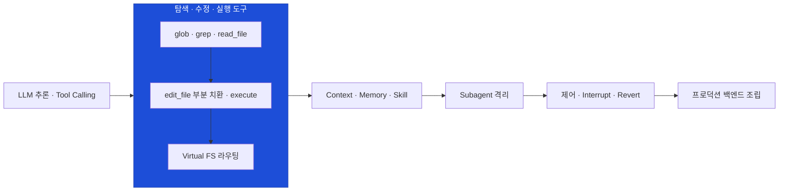

파일 수백 개가 있는 실제 저장소에서 파일을 통째로 읽고 통째로 덮어쓰면 Context가 금방 차오르고 기존 코드를 유실하기 쉽습니다. `deepagents` 라이브러리가 기본 제공하는 파일·검색 도구 스키마 위에, 멀티세션 동적 경로 라우팅을 직접 구현해 결합했습니다.

### 2-1. 탐색 도구 체인: `ls` → `glob` → `grep` → `read_file(offset, limit)`

`deepagents`가 기본 제공하는 네 가지 읽기 도구를 조합해 필요한 코드 구간만 좁혀 읽습니다.

| 도구 (`deepagents` 제공) | 역할 | 반환 형태 |
| :--- | :--- | :--- |
| **`ls(path)`** | 디렉터리 직속 구조 파악 | 파일·폴더 이름 목록 |
| **`glob(pattern)`** | 파일명 패턴 검색 (예: `**/*pricing*.py`) | 매칭된 경로 목록 |
| **`grep(pattern, path)`** | 코드 내 심볼·문자열 검색 (예: `def apply_discount`) | `경로:줄번호:매칭된 줄` |
| **`read_file(file_path, offset, limit)`** | `grep`으로 찾은 줄 번호 주변 구간만 부분 읽기 | 줄 번호가 붙은 지정 범위 원문 |

### 2-2. 전체 덮어쓰기 대신 `edit_file(old_string, new_string)`

기존 파일을 고칠 때 전체 내용을 다시 생성하는 `write_file`을 쓰면, 긴 파일에서 출력이 느려지고 모델이 중간 코드를 임의로 생략(`# ... 생략 ...`)해 구문 오류를 내는 문제가 발생합니다.

따라서 새 파일 생성에만 `write_file`을 쓰고, 기존 파일 수정은 바뀔 구간만 정확히 짚어 치환하는 `edit_file`(`deepagents` 기본 도구)을 사용합니다.

```json
{
  "name": "edit_file",
  "arguments": {
    "file_path": "/pricing.py",
    "old_string": "def apply_discount(price: int, rate: float) -> int:\n    return int(price * (1 - rate))",
    "new_string": "def apply_discount(price: int, rate: float) -> int:\n    if rate < 0 or rate > 1:\n        raise ValueError('rate must be between 0 and 1')\n    return int(price * (1 - rate))"
  }
}
```

모델이 최신 파일을 읽지 않은 채 기억에 의존해 `old_string`을 넘기면 원문 매칭에 실패해 즉시 에러가 반환됩니다. 덕분에 파일을 먼저 읽고 정확히 일치하는 구간만 수정하도록 자연스럽게 강제됩니다.

### 2-3. Virtual Filesystem 라우팅 (`DynamicRunBackend` 직접 구현)

에이전트는 소스 코드 외에도 계획서(`implementation_plan.md`), 할 일 목록(`task.md`), 프로젝트 메모(`AGENTS.md`), 스킬 문서를 읽고 씁니다. 이 파일들을 사용자의 실제 Git 저장소에 직접 쓰면 작업 트리가 오염됩니다.

`deepagents`는 경로 접두사별로 백엔드를 나누는 `CompositeBackend` 베이스 클래스를 제공하지만, 생성 시점에 단일 경로가 고정되어 여러 세션이 공유하는 웹 서버에서는 그대로 쓸 수 없습니다. 이를 상속해 실행 중인 세션의 `RunContext`(`ContextVar`[^5])에 맞춰 물리 폴더를 실시간 연결하는 `DynamicRunBackend`(`domains/agent/run_backends.py`)를 직접 구현했습니다.

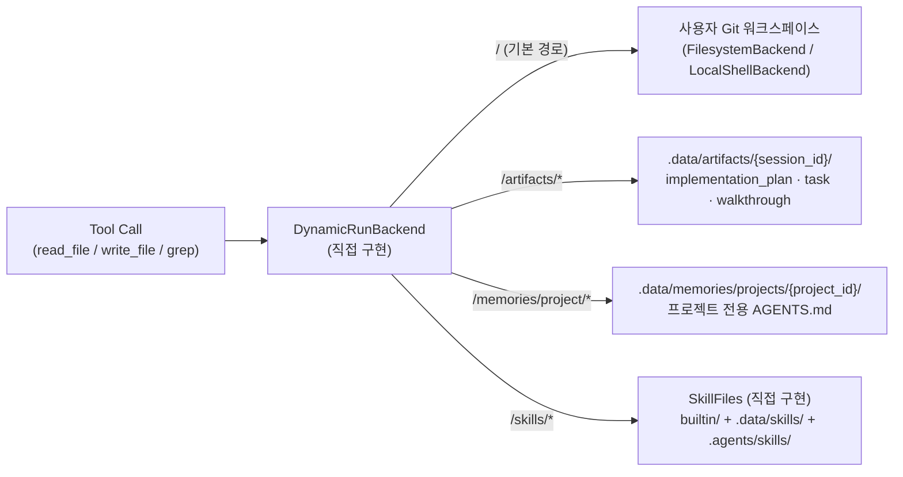

---

## 3. Context · Memory · Skill 관리

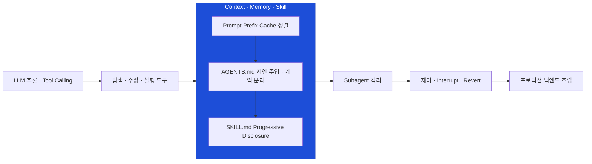

루프가 길어질수록 두 가지 문제가 생깁니다.
- **Context Rot**: 규칙 문서, 수십 개의 도구 스키마, 탐색 결과가 한데 뒤섞이면 모델이 핵심 지시를 놓치기 시작합니다.
- **Prefix Cache 깨짐**: 시스템 프롬프트 앞부분이 조금만 달라져도 추론 서버가 이전 KV Cache[^2]를 재사용하지 못해 응답 지연과 비용이 늘어납니다.

클로드 코드(Claude Code) 등 최근 코딩 에이전트들이 채택한 Context Engineering 기법 세 가지를 커스텀 미들웨어와 스킬 스토어로 구현했습니다.

### 3-1. Prompt Prefix Cache 정렬 (`RunPromptMiddleware` 직접 구현)

LLM 서버는 요청 프롬프트의 **앞부분(Prefix)이 직전 호출과 완전히 일치할 때** 연산 캐시를 재사용합니다. LangChain의 `AgentMiddleware` 인터페이스를 구현한 `RunPromptMiddleware`(`domains/agent/middleware/run_prompt.py`)는 매 모델 호출 직전(`awrap_model_call`) 시스템 프롬프트를 **정적인 항목에서 동적인 항목 순서**로 배치합니다.

```text
[1. 완전 고정] 기본 도구 명세 + 공통 행동 지침 (_BASE_AGENT_GUIDANCE)
      ↓
[2. 모드별 고정] 현재 실행 모드 정책 (Ask / Plan / Auto)
      ↓
[3. 프로젝트 고정] 루트 /AGENTS.md + /memories/project/AGENTS.md
      ↓
[4. 세션별 고정] 현재 워크스페이스 경로 · 세션 ID
      ↓
[5. 매 턴 추가] 사용자 메시지 · AIMessage(tool_calls) · ToolMessage 결과
```

한 세션에서 도구 루프가 반복되는 동안 1~4번 구간은 바이트 단위로 동일하게 유지되어 Prefix Cache 적중률을 높입니다.

### 3-2. 계층형 `AGENTS.md` 지연 주입과 단기/장기 기억 분리

백엔드만 고치는 세션에 프론트엔드 전용 규칙 수백 줄을 미리 넣어두면 불필요한 토큰만 소모됩니다. 이를 두 개의 커스텀 미들웨어로 분리해 처리했습니다.

- **매 턴 최신 메모리 로드 (`DynamicMemoryMiddleware` 확장 구현)**
  - `deepagents` 기본 `MemoryMiddleware`는 첫 턴에 읽은 메모리를 체크포인트 상태에 캐싱해 두기 때문에, 도중에 사용자가 메모리를 수정해도 반영되지 않는 한계가 있었습니다.
  - 이를 상속해 매 턴 시작(`abefore_agent`)마다 루트 `/AGENTS.md`와 `/memories/project/AGENTS.md`를 디스크에서 새로 읽도록 오버라이드했습니다(`domains/agent/middleware/memory.py`).
  - 동시에 세션 단기 산출물(`/artifacts/`)과 프로젝트 장기 기억(`/memories/project/`) 경로를 분리해 프로젝트 간 컨텍스트 오염을 막았습니다.
- **하위 폴더 규칙 지연 주입 (`SubdirAgentsReadMiddleware` 직접 구현)**
  - 하위 폴더의 `AGENTS.md`는 초기 프롬프트에 넣지 않습니다.
  - 에이전트가 `read_file("/frontend/src/App.tsx")`를 호출하는 순간 미들웨어(`awrap_tool_call`)가 상위 폴더들을 검사해 `/frontend/AGENTS.md`를 찾아내고, 해당 세션에서 처음 접근했을 때 딱 한 번 `ToolMessage` 결과에 합쳐 반환합니다(`domains/agent/middleware/subdir_agents.py`).

### 3-3. Tool Bloat 방지와 `SKILL.md` Progressive Disclosure

기능이 늘어날 때마다 전용 Tool을 계속 추가하면 매 턴 수십 개의 JSON 스키마가 전송되어 토큰이 낭비되고 도구 선택 정확도가 떨어집니다.

이를 막기 위해 코어 도구는 9개(`deepagents` 기본 8종 + 직접 구현한 `ask_user` 1종)로 고정하고, 코드베이스 온보딩(`codebase-onboarding`)·검증 절차(`verify`)·외부 `skills.sh` 패키지는 `/skills/<name>/SKILL.md` 문서로 분리했습니다.
- 평소 프롬프트에는 스킬 이름과 1줄 요약 목차만 노출됩니다(`deepagents` 스킬 로더 + 직접 구현한 `SkillFiles` 가상 병합 백엔드).
- 해당 작업이 필요할 때만 에이전트가 `read_file("/skills/verify/SKILL.md")`로 본문을 읽어 절차를 수행합니다.

---

## 4. Subagent Context Isolation

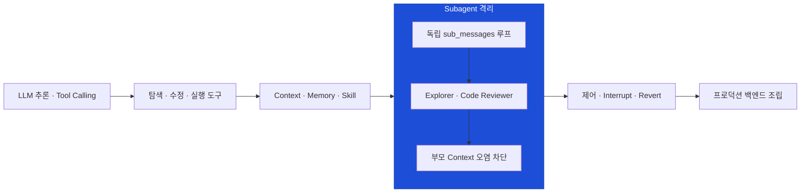

광범위한 코드 탐색을 메인 에이전트에서 직접 수행하면 수십 번의 `grep`·`read_file` 원문이 메인 `messages`에 그대로 남아 정작 코드를 수정할 때 Context 절반을 잠식합니다. 또한 코드를 작성한 에이전트가 같은 문맥에서 자기 코드를 스스로 리뷰하면 자신이 세운 가정에 갇혀 결함을 놓치기 쉽습니다.

### 4-1. 독립 `sub_messages` 루프 동작 구조

`deepagents`가 제공하는 `task` 도구가 호출되면, 부모의 `messages` 이력을 복사하지 않는 **빈 `sub_messages` 배열과 별도의 서브그래프 루프**가 실행됩니다.

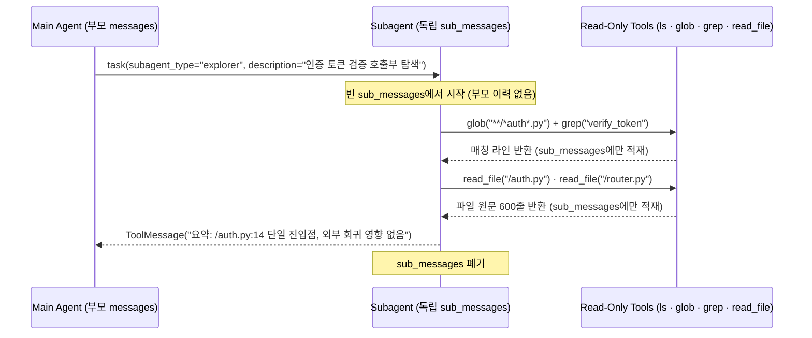

수백 줄의 파일 원문과 중간 검색 로그는 서브에이전트 종료와 함께 소멸하고, 부모 `messages`에는 최종 요약 `ToolMessage` 한 건만 남습니다.

### 4-2. `Explorer` · `Code Reviewer` 구성 및 스트림 매핑 (직접 구현)

서브에이전트 실행기 자체는 `deepagents`의 `task` 메커니즘을 쓰되, 역할 정의·쓰기 차단·실행 추적은 직접 구현했습니다.

- **역할 분리 (`domains/agent/subagents.py`)**
  - **`explorer`**: 호출 관계 및 의존성 매핑 결과를 파일 경로·줄 번호 중심으로 요약해 반환합니다.
  - **`reviewer`**: 수정이 끝난 뒤 변경분(`git diff` 및 타깃 파일)을 작성 맥락 없이 백지상태에서 검토해 `[Important]` · `[Nit]` · `[Pre-existing]` 기준으로 결함을 보고합니다.
- **읽기 전용 강제 (`ReadOnlyToolGuardMiddleware` 직접 구현)**
  - 두 서브에이전트 모두 모델 호출 전 쓰기·셸 도구를 목록에서 제거하고, 혹시 호출을 시도하더라도 미들웨어에서 즉시 차단합니다.
- **부모-자식 실행 추적 (`DeepAgentHarness` 직접 구현)**
  - LangGraph 서브그래프 스트리밍 메타데이터의 `lc_subagent_tool_call_id`와 `lc_agent_name`을 파싱해 하위 도구 이벤트를 부모 `task`의 `parent_id`로 연결합니다(`domains/agent/harness.py`). 이를 통해 UI에서 각 서브에이전트가 내부적으로 어떤 파일을 읽었는지 카드 단위로 묶어 확인할 수 있습니다.

---

## 5. 실행 제어, HITL Interrupt, Revert

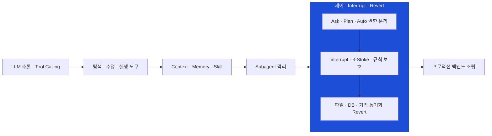

자율 에이전트를 안전하게 운영하려면 **권한 경계**, **실행 중 사용자 개입(Human-in-the-Loop)**, **무한 재시도 차단**, 그리고 **완전한 되돌리기(Revert)**가 필요합니다.

### 5-1. 실행 모드 물리 분리와 `ShellGuard` (직접 구현)

프롬프트 지시만으로는 파일 수정이나 위험 명령을 막을 수 없어 모드별로 백엔드와 미들웨어 게이트를 물리적으로 분리했습니다.

- **`Ask` 모드**: `execute` 도구가 없는 `FilesystemBackend`를 마운트하고 `/artifacts/` 외 모든 파일 쓰기를 거부합니다.
- **`Plan` 모드**: `ArtifactWorkflowMiddleware`가 사용자 승인(`plan_approved=True`) 전까지 모든 워크스페이스 수정과 셸 실행을 차단합니다.
- **`Auto` 모드 + `ShellGuard`(`domains/agent/shell_guard.py`, 표준 라이브러리 단독 구현)**:
  - 모든 `pytest`·`ruff` 실행마다 승인을 요구하면 작업 흐름이 끊깁니다.
  - 시스템 파괴 명령(`rm -rf /` 등)은 즉시 차단(`BLOCK`)하고 일반 개발·테스트 명령은 자동 허용(`ALLOW`)하되, **`rm`, `git push`, `git reset --hard`, `git clean`, `git checkout --`처럼 복구가 어려운 명령만 골라 사용자 승인(`REQUIRE_APPROVAL`)을 요청**합니다.

### 5-2. LangGraph `interrupt()` 기반 일시 정지와 재개

단순 `while`문에서는 에이전트가 도중에 사용자에게 선택지를 묻거나(`ask_user`) 명령 승인을 기다릴 때 HTTP 연결을 계속 붙잡고 있어야 합니다.

이를 해결하기 위해 **LangGraph가 제공하는 `AsyncSqliteSaver` 체크포인터와 `interrupt()` / `Command(resume=...)` 프리미티브** 위에 질문 도구(`ask_user`, 직접 구현)와 승인 미들웨어(`ArtifactWorkflowMiddleware`, 직접 구현)를 얹었습니다.

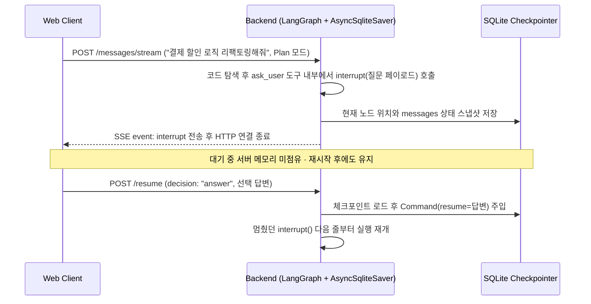

도구 내부에서 `decision = interrupt(payload)`를 호출하면 그래프가 즉시 멈추며 상태를 SQLite에 저장합니다. 이후 `POST /resume`으로 전달된 응답이 `decision` 변수에 대입되면서 멈췄던 지점부터 자연스럽게 이어집니다.

### 5-3. 검증 루프 3-Strike 규칙과 심판 파일 보호 (직접 구현)

에이전트가 스스로 테스트를 돌려 코드를 고칠 때 발생하는 두 가지 부작용을 커스텀 미들웨어로 제어했습니다.

- **Three-Strike 중단 규칙 (`VerificationLoopMiddleware`, `domains/agent/middleware/verification.py`)**
  - 코드 수정 후 검증 명령(`pytest`, `ruff`, `npm test` 등)의 종료 코드(`exit_code`)를 추적합니다.
  - 연속 3회 실패하면 무분별한 코드 덧칠을 멈추고 실패 원인과 로그를 정리해 보고하도록 지침을 주입합니다.
  - 테스트 통과(`passed`) 직후 파일을 다시 수정하면 기존 통과 스탬프를 즉시 무효화해 재검증을 강제합니다.
- **검증 기준 자기수정 보호 (`ShellGuard.is_verifier_rule_path` + `ArtifactWorkflowMiddleware`)**
  - 에이전트가 테스트를 통과시키려고 `AGENTS.md`, `.github/workflows/*`, `test_architecture_boundaries.py` 같은 규칙·테스트 설정 파일 자체를 임의로 완화하지 못하도록, 해당 경로 쓰기 시도는 `Auto` 모드에서도 무조건 `interrupt()` 승인을 거치게 막았습니다.

### 5-4. 파일 · DB · LLM 기억을 함께 되감는 동기화 Revert (직접 구현)

멀티턴 작업 중 *"턴 1의 미커밋 코드는 살리고, 방금 실패한 턴 2만 되돌리고 싶다"*는 상황에서 `git checkout -- .`을 쓰면 턴 1 작업까지 사라집니다. 또한 **디스크 파일만 복구하고 LangGraph 체크포인터 속 대화 기억을 그대로 두면, 모델은 다음 턴에 이미 지워진 턴 2 코드가 여전히 존재하는 줄 알고 환각(Hallucination)을 일으킵니다.**

LangGraph는 파일 롤백 기능을 제공하지 않으므로, Content-Addressed[^8] 파일 스냅샷 엔진인 `TurnCheckpointStore`(`domains/agent/checkpoints.py`)와 `SessionService.revert_from_message`(`domains/sessions/service.py`)를 직접 구현해 세 저장소를 함께 되감습니다.

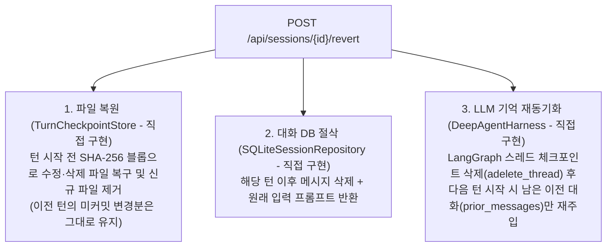

`TurnCheckpointStore`는 파일 원문을 SHA-256 해시 이름의 블롭으로 중복 없이 저장하고, 턴 종료 시 변경된 파일만 매니페스트에 기록합니다. 스캔 비용을 줄이기 위해 `(mtime_ns, ctime_ns, size, ino)`가 동일하고 수정 시각이 스냅샷 시작보다 2초 이상 과거인 파일은 재해싱을 생략하되, 2초 이내 동일 크기 수정(Racy-Git 조건[^9])은 다시 해싱해 누락을 막습니다.

---

## 6. 프로덕션 백엔드 조립 (Middleware · ContextVar · SSE · DDD)

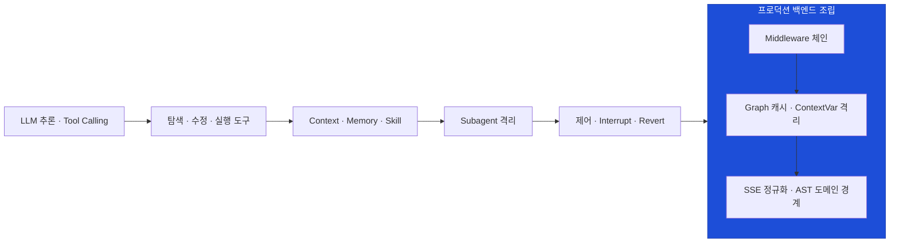

마지막 단계는 개별 컴포넌트들을 멀티세션 웹 서버 안에서 상태 충돌이나 결합도 오염 없이 묶어내는 백엔드 구조입니다.

### 6-1. Middleware 체인 조립 순서

`DeepAgentHarness`(`domains/agent/harness.py`)는 `create_deep_agent`(`deepagents` 제공)를 호출할 때 기본 `TodoListMiddleware` 1종과 직접 구현한 커스텀 미들웨어 8종을 아래 순서로 연결합니다.

- **`TodoListMiddleware`** *(LangChain 제공)*: `write_todos` 체크리스트 상태 관리
- **`RunPromptMiddleware`** *(직접 구현)*: Prefix Cache 친화적 시스템 프롬프트 조립
- **`DynamicMemoryMiddleware`** *(확장 구현)*: 매 턴 루트 `/AGENTS.md` 및 프로젝트 메모리 디스크 재로드
- **`SubdirAgentsReadMiddleware`** *(직접 구현)*: 하위 디렉터리 파일 열람 시 로컬 `AGENTS.md` 지연 주입
- **`ToolErrorMiddleware`** *(직접 구현)*: 일반 도구 오류는 모델 자가 복구용 `ToolMessage`로 변환하되, LangGraph `GraphBubbleUp`(`interrupt`)과 `CancelledError`는 삼키지 않고 즉시 전파
- **`ModelRetryMiddleware`** *(직접 구현)*: 일시적 네트워크 오류 백오프 재시도
- **`GitEvidenceMiddleware`** *(직접 구현)*: 턴 전 파일 스냅샷 캡처 및 변경 직후 단일 프로세스(`git status --porcelain=v2 --branch -z`)로 Git diff 추적
- **`VerificationLoopMiddleware`** *(직접 구현)*: 수정 대비 검증 실행 추적 및 3-Strike 제어
- **`ArtifactWorkflowMiddleware`** *(직접 구현)*: `Plan` 승인 게이트, 검증 규칙 파일 보호, HITL 인터럽트 조율

### 6-2. Graph LRU 캐시 공유와 `ContextVar` 실행 격리 (직접 구현)

컴파일된 LangGraph 객체를 매 요청마다 새로 만들면 오버헤드가 크고, 반대로 인스턴스 하나를 여러 세션이 그냥 공유하면 워크스페이스 경로가 섞입니다.

이를 해결하기 위해 **컴파일된 그래프는 `(모델 설정 해시, 실행 모드)` 키로 LRU 캐시[^10]에서 재사용**하고, 실행 시점의 세션 경로·아티팩트 폴더·시크릿은 불변 객체 `RunCatalog`에 담아 Python 표준 `contextvars.ContextVar`[^5](`RunContext`)로 바인딩합니다.

```python
# 컴파일된 graph는 공유하되, 실행 경로와 상태는 비동기 태스크별로 격리됩니다.
async with RunContext.activate(catalog):
    async for item in graph.astream(
        graph_input,
        config={"configurable": {"thread_id": catalog.session_id}},
    ):
        ...
```

동일 세션에 동시에 중복 스트림 요청이 들어오는 경우는 FastAPI `EventSourceResponse`가 열리기 전 라우터 `Depends` 단계에서 인메모리 활성 셋으로 검사해 즉시 `409 SESSION_RUNNING`을 반환합니다.

### 6-3. 스트림 중단(`Abort`) 복구, 보안, AST 도메인 경계 (직접 구현)

- **스트림 중단 시 스냅샷 회수 (`asyncio.shield`)**
  - 사용자가 실행 중 `Stop`을 누르거나 화면을 전환해 SSE[^11] 연결이 끊기면 `CancelledError` / `GeneratorExit`가 발생합니다.
  - `SessionService._consume_and_persist_stream`은 `finally` 블록을 `asyncio.shield`[^12]로 보호해 하위 스트림을 닫고, 중단 직전까지 수정된 파일 매니페스트(`finalize_pending_capture`)와 누적 메시지를 끝까지 저장합니다. 덕분에 중도 취소된 턴도 정상적으로 `Revert`할 수 있습니다.
- **Zero-Persistence 자격증명 보안**
  - LLM URL과 API 키는 브라우저에만 두고 매 요청 `X-LLM-*` 헤더로만 전달받으며, 서버 DB나 체크포인트에는 저장하지 않습니다. 모든 로그는 `SecretRedactionFilter`를 거쳐 키 문자열을 마스킹합니다.
- **AST 정적 검사[^13]로 강제하는 DDD 경계[^14] (`tests/test_architecture_boundaries.py`)**
  - 백엔드를 `sessions`, `agent`, `artifacts`, `skills` 도메인과 `shared`로 분리하고 파이썬 `ast` 모듈로 모든 파일의 `import` 구문을 테스트에서 검증합니다. `agent`가 `sessions`를 참조하거나 `artifacts`가 `langgraph`를 참조하면 즉시 테스트가 실패해 도메인 간 역참조를 차단합니다.
- **프론트엔드 연결 원칙 요약**
  - 프론트엔드는 원본 SSE 이벤트와 메시지 배열을 변형 없이 보존하고, 렌더링 직전 순수 셀렉터 함수로만 연속 탐색 그룹과 서브에이전트 카드를 계산합니다. UI는 커스텀 CSS 없이 `@astryxdesign/core` 컴포넌트 조합만으로 구성했습니다.

---

## Lessons Learned

구현 초기의 단순한 가정과 실제로 부딪히며 검증한 엔지니어링 교훈을 정리합니다.

- **프롬프트 제약 대신 백엔드 권한을 물리적으로 분리해야 합니다**
  - 컨텍스트가 길어지면 모델은 *"수정하지 마라"*는 프롬프트 지시를 종종 어깁니다. 읽기 전용 모드에서는 `execute` 도구가 없는 백엔드를 마운트하고, 검증 규칙 파일은 미들웨어에서 물리적으로 쓰기 승인을 걸어야 오작동을 원천 차단할 수 있습니다.
- **승인 팝업 남발은 안전장치가 아니라 사용성 파괴로 이어집니다**
  - 모든 셸 명령마다 승인을 요구하면 `pytest` 한 번 돌릴 때마다 흐름이 끊기고, 결국 사용자가 내용을 보지 않고 승인 버튼을 연타하게 됩니다. 안전한 조회·검증 명령은 자동 통과시키고 `rm`·`git push`·`git reset --hard` 같은 파괴적 명령만 선별해 멈추게 했을 때 실질적인 안전성과 속도를 함께 얻었습니다.
- **도구 개수는 고정하고 절차 지식은 `SKILL.md`로 지연 로드해야 합니다**
  - 기능을 추가할 때마다 전용 Tool을 늘리면 매 턴 고정 스키마 토큰만 커지고 선택 정확도가 떨어집니다. 코어 도구는 최소한으로 유지하고 세부 절차는 필요할 때만 `read_file`로 읽는 Progressive Disclosure 구조가 훨씬 효율적이었습니다.
- **대량 탐색과 코드 리뷰는 별도 서브에이전트 문맥으로 격리해야 합니다**
  - 한 스레드에서 탐색·구현·리뷰를 모두 처리하면 수천 줄의 파일 원문이 문맥을 오염시키고 자기가 짠 코드를 관대하게 평가합니다. 빈 `sub_messages`에서 도는 읽기 전용 `explorer`와 `reviewer`로 분리해 요약만 돌려받는 방식이 문맥 절약과 리뷰 객관성 양쪽에서 효과적이었습니다.
- **일반 도구 오류와 런타임 제어 예외(`interrupt` · `CancelledError`)는 엄격히 구분해야 합니다**
  - 파일 경로 오타나 문자열 불일치는 `ToolMessage`로 돌려줘야 모델이 스스로 고쳐 재시도하지만, LangGraph `interrupt()`나 스트림 취소 예외까지 `except Exception`류로 삼켜버리면 일시 정지와 취소가 망가집니다. 복구 대상 오류와 상태 머신 제어 신호를 분리해 전파하는 것이 안정성의 핵심이었습니다.
- **에이전트의 Revert는 파일·DB·체크포인터 기억을 함께 되감아야 합니다**
  - 디스크 파일만 이전 상태로 돌리고 체크포인터의 대화 기억을 남겨두면, 모델은 이미 사라진 코드를 전제로 다음 수정을 시도해 꼬이게 됩니다. SHA-256 파일 복원, SQLite 메시지 절삭, LangGraph 스레드 재주입(`prior_messages`)을 한 단위로 묶어야 일관성이 유지됩니다.
- **도메인 경계는 문서 규칙이 아니라 AST 단위 테스트[^13]로 잠가야 유지됩니다**
  - 기능이 늘어날수록 편의를 위해 도메인 간 직접 `import`를 추가하려는 유혹이 생깁니다. `test_architecture_boundaries.py`로 의존성 위반을 자동 차단하고 파일 수정·복원 불변식 테스트[^15]를 함께 돌린 덕분에 반복적인 구조 개편에서도 회귀 없이 아키텍처를 유지할 수 있었습니다.

---

## 한계점 및 후속 과제

이번 구현에서 미처 다루지 못해 다음 단계로 남겨둔 아키텍처 과제입니다.

### 작업 도중 메시지 큐를 통한 실시간 방향 전환 (`Mid-Run Steering`)

- **현재 구조의 한계**
  - 현재는 세션이 `RUNNING` 상태일 때 동일 세션으로 추가 메시지 요청이 들어오면 상태 경합과 메시지 뒤섞임을 막기 위해 API 진입부에서 `409 SESSION_RUNNING`으로 즉시 거절합니다.
  - 이 때문에 에이전트가 작업 도중 엉뚱한 디렉터리를 탐색하거나 요구사항을 다르게 해석해 진행하고 있어도, 실행 흐름을 유지한 채 *"그 모듈 말고 `auth/` 쪽부터 확인해 줘"*처럼 중간에 방향만 틀어줄 수 없습니다. 사용자가 일단 `Stop`(`Abort`)으로 현재 스트림을 강제 종료한 뒤 새 턴을 다시 열어야 하므로, 직전까지 쌓인 추론 맥락이 끊기는 아쉬움이 있습니다.
- **후속 구현 방향 (`In-Flight Message Queue` 주입)**
  - 세션별 비동기 메시지 큐(`asyncio.Queue`)와 실행 중 개입 전용 엔드포인트(예: `POST /api/sessions/{id}/steer`)를 두어, `RUNNING` 상태에서도 사용자의 추가 지시를 큐에 논블로킹[^16]으로 적재하는 구조를 구상하고 있습니다.
  - LangGraph 상태 머신에서는 진행 중인 도구 실행을 강제로 끊지 않고 안전하게 마무리한 직후, 다음 모델 추론에 들어가기 전 미들웨어 훅(`abefore_model`)에서 큐를 비워(`drain`) 대기 중인 사용자 지시를 `messages` 배열 끝에 `HumanMessage`로 합류시킵니다.
  - 이렇게 확장하면 파일 스냅샷이나 서브프로세스 무결성을 해치지 않으면서도, 에이전트가 다음 추론 스텝부터 즉시 바뀐 지시사항을 반영해 작업을 이어갈 수 있습니다.

---

[^1]: **RAG (Retrieval-Augmented Generation, 검색 증강 생성)**: 모델이 학습하지 않은 사내 문서나 최신 정보를 답할 수 있도록, 질문과 관련된 자료를 외부 저장소에서 먼저 검색해 프롬프트에 참고 문맥으로 함께 넣어주는 방식입니다.
[^2]: **Prompt Prefix Caching & KV Cache**: LLM 추론 서버가 직전 요청과 앞부분(Prefix) 토큰열이 동일할 때, 이미 계산해 둔 어텐션 중간 연산값(`KV Cache`)을 메모리에 남겨 두었다가 재사용해 응답 대기 시간과 연산 비용을 크게 줄이는 기법입니다.
[^3]: **ACI (Agent-Computer Interface)**: 사람이 화면과 마우스로 프로그램을 다루는 UI(HCI)에 대응하는 개념으로, LLM 에이전트가 실수 없이 도구를 호출하고 실행 결과를 정확히 해석할 수 있도록 입출력 인자 구조와 에러 피드백 형식을 설계하는 인터페이스입니다.
[^4]: **Path Traversal (경로 이탈)**: `../../etc/passwd` 같은 상대 경로나 심볼릭 링크를 조합해 허용된 작업 디렉터리 바깥의 상위 시스템 파일에 접근하거나 수정하려는 행위입니다.
[^5]: **ContextVar (`contextvars.ContextVar`)**: 단일 서버 프로세스가 여러 비동기 요청을 동시에 처리할 때, 함수 인자로 일일이 넘기지 않고도 각 요청(Task)마다 값이 섞이지 않는 독립된 실행 컨텍스트 저장소를 제공하는 Python 표준 라이브러리 기능입니다.
[^6]: **Stateless (무상태성)**: 서버가 이전 요청의 대화 상태를 내부에 기억하지 않고 매 HTTP 요청을 독립적인 새 요청으로 처리하는 성질입니다. 대화를 이어가려면 호출할 때마다 누적된 전체 메시지 배열을 다시 전달해야 합니다.
[^7]: **JSON Schema**: 함수가 어떤 이름의 인자를 받으며 각 인자의 자료형(문자열, 정수 등)과 필수 여부가 무엇인지 기계가 읽고 검증할 수 있도록 표준 JSON 형식으로 정의한 명세입니다.
[^8]: **Content-Addressed Storage (내용 기반 주소 저장소)**: 파일 이름이 아니라 파일 원문으로부터 계산한 암호화 해시값(`SHA-256`) 자체를 파일 식별자로 삼아 저장하는 방식입니다. 내용이 같으면 동일한 블롭(원본 조각) 하나만 공유하므로 중복 저장이 발생하지 않고, 매니페스트(변경 목록표)에는 경로별 전후 해시값만 기록합니다.
[^9]: **Racy-Git 조건**: 스냅샷을 찍은 직후 아주 짧은 시간(파일시스템 타임스탬프 해상도 구간) 안에 파일 내용이 우연히 같은 바이트 크기로 바뀔 경우, 수정 시각(`mtime`)과 파일 크기(`size`) 비교만으로는 변경 사실을 놓치게 되는 현상입니다. Git 내부 구현에서 유래한 용어로, 이 구간의 파일은 해시를 다시 계산해 누락을 막습니다.
[^10]: **LRU (Least Recently Used) 캐시**: 정해진 캐시 용량이 가득 찼을 때 가장 오랫동안 참조되지 않은 항목부터 비워 메모리 사용량을 일정 한도 안으로 유지하는 캐시 교체 방식입니다.
[^11]: **SSE (Server-Sent Events)**: 하나의 HTTP 연결을 열어 두고 서버에서 클라이언트로 생성 중인 텍스트 조각과 도구 실행 이벤트를 실시간 단방향 스트림으로 전달하는 웹 표준 프로토콜입니다.
[^12]: **`asyncio.shield`**: 클라이언트 연결 종료 등으로 상위 비동기 작업에 취소 신호(`CancelledError`)가 전달되더라도, 보호 대상인 내부 정리 작업(DB 기록, 파일 스냅샷 마감 등)만큼은 중단되지 않고 끝까지 완료되도록 감싸는 Python 비동기 제어 함수입니다.
[^13]: **AST (Abstract Syntax Tree, 추상 구문 트리) 및 AST 단위 테스트**: 소스 코드를 실행하지 않고 문법 구조(어떤 모듈을 `import`하는지, 어떤 함수·클래스가 선언되었는지 등)만 트리 형태의 데이터로 파싱한 결과물입니다. **AST 단위 테스트**는 파이썬 내장 `ast` 모듈로 전체 코드의 `import` 구문을 정적으로 전수 검사해, 허용되지 않은 도메인 간 참조가 한 줄이라도 발견되면 즉시 테스트를 실패시키는 아키텍처 검증 기법입니다.
[^14]: **DDD (Domain-Driven Design, 도메인 주도 설계)**: 소프트웨어를 핵심 역할·책임 단위(도메인)로 분리하고, 각 도메인이 내부 구현을 숨긴 채 명시된 경계와 인터페이스를 통해서만 협력하도록 구조화하는 설계 방식입니다.
[^15]: **불변식 테스트 (Invariant Test)**: 개별 함수의 단순 입출력 확인을 넘어, 어떤 작업이나 상태 전이가 일어난 뒤에도 시스템 전체가 반드시 지켜야 하는 핵심 조건(예: *"턴 실행 후 Revert를 수행하면 모든 파일 해시와 남는 대화 목록이 턴 시작 전 상태와 정확히 일치해야 한다"*)이 깨지지 않았는지 검증하는 테스트입니다.
[^16]: **논블로킹 (Non-blocking)**: 먼저 실행 중인 작업이 끝날 때까지 요청자가 멈춰 기다리지 않고, 큐에 요청만 즉시 등록한 뒤 곧바로 제어를 돌려받는 처리 방식입니다.
